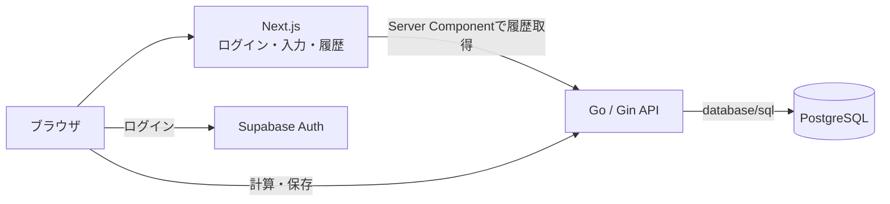
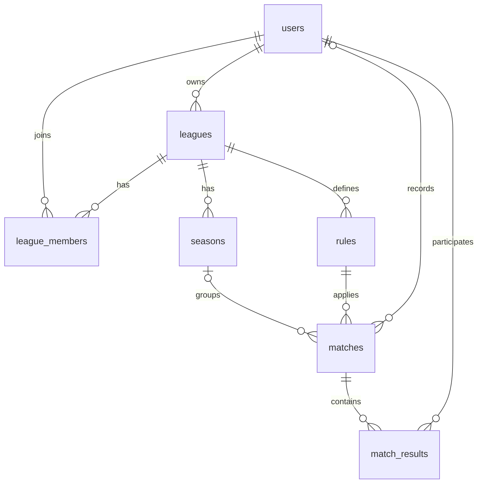
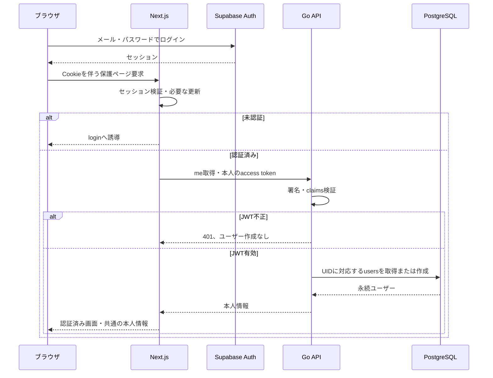

# アーキテクチャとデータ設計

## 現在の構成

| 層 | 実装と主な責務 | 根拠 |
| --- | --- | --- |
| Web | Next.js 16.2.3 / React 19.2.4 / TypeScript。ログイン、対局入力、履歴表示 | [package.json](../web/package.json)、[app](../web/src/app) |
| UI・入力 | Tailwind CSS 4、Base UIを使ったUI部品、React Hook Form、Zod | [UI部品](../web/src/components/ui)、[履歴カード](../web/src/components/match-card.tsx) |
| Auth | Supabase Auth。ブラウザのメール・パスワードログインとCookieベースのWebセッション | [login/page.tsx](../web/src/app/login/page.tsx)、[proxy.ts](../web/src/proxy.ts) |
| API | Go。`go.mod` はGo 1.26.2。Gin、`database/sql`、`lib/pq` を使用 | [go.mod](../api/go.mod)、[main.go](../api/main.go) |
| DB | `DATABASE_URL` でPostgreSQLへ直接接続。Supabase上のDBを想定 | [database.go](../api/db/database.go)、[.env.example](../api/.env.example) |

依存関係の正確なバージョンは `web/package-lock.json` と `api/go.sum` を参照する。WebとAPIは別プロセスで、現在はWeb内のRoute Handlerを介さずGoを呼び出す。



Step 1ブランチではGoに共通JWT/主体/セッション検証を追加した。ブラウザ・SSRとも本人access tokenを転送する。共有DB/Authには未適用で、後述の39列等は以前の共有DBの読み取り観測として維持する。

## コードの責務

- `api/main.go`：起動、DB接続、CORS、ルート登録。
- `api/controllers`：HTTP入出力、ポイント計算、SQL、トランザクション。現状はこれらが同居している。
- `api/models`：APIのリクエスト・レスポンス型。DB全体のスキーマ定義ではない。
- `api/db`：接続処理と旧seed。DB正本は `supabase/migrations`。`supabase/permissions` はD-41で置換した旧方式の記録。
- `web/src/app`：画面とServer Componentによる履歴取得。
- `web/src/components/match`：入力・計算プレビュー・保存。現在はメンバー・ルールの取得元に負債がある。
- `web/src/types`：履歴APIのWeb側型。Goの変更と同時に更新する。

今後、認証を共通処理にし、ポイント計算をHTTPや表示から独立して検証できる境界へ置く。リーグ・ルール取得、保存時検証、集計、SVG描画は必要なStepで責務を分ける。将来のためだけに未使用の抽象化や空のレイヤーを大量に作らない。

## Step 1作業ブランチの実装境界

- `api/auth` が固定プロジェクトのES256/JWKS（5分キャッシュ、取得3秒/256KiB、未知kidの更新冷却30秒）、issuer/audience/role/anonymous/sub/session_id/時刻を検証する。Auth有効性は成功キャッシュへ置かない。
- `api/httpx` がprivate, no-store、request_id、共通エラー、64KiB/strict JSONを扱う。Goはリクエスト・SQLエラー・資格情報をログ出力せず、障害を認証成功へ読み替えない。
- `api/controllers/users_controller.go` はAuthロック後のtxでauth_id競合を解決し、DBが独立UUIDを生成する。名前と完了時刻を一括更新し、完了時刻は再変更で維持する。通常の対局APIは未作成/未設定を403とする。
- `web/src/lib/auth`、`lib/supabase` と認証用画面/Provider/`proxy.ts` を追加。SSRはリクエスト単位の本人取得、ブラウザはSDKセッションからBearerを付ける。401だけ更新後最大1回再送し、通信/5xxで保存を自動再送しない。本人切替・localログアウトは表示状態とRouter Cacheを破棄する全画面遷移を使う。
- `users.participant_kind`、`profile_completed_at`、`version` とauth_idのSET NULL FKを追加。旧未紐付けはlegacy、明示済みauth_idだけregisteredとし、名前/IDで本人を推測しない。Auth削除でもregisteredをguestへ変えない。
- 通常migrationは `mjstats_private.valid_session` の定義とPUBLIC剥奪・Go限定EXECUTEを同一txで作る。所有者はNOLOGIN/NOBYPASSRLS、APIはLOGIN/NOBYPASSRLS、両方NOINHERIT。GoにAuth表の直接権限・物理DELETEを与えない。
- D-41の通常migrationだけで限定Auth検証を構成する。postgres所有の非公開viewが必要7列だけを投影し、NOLOGIN/NOBYPASSRLSの関数所有ロールにはviewのSELECT/UPDATE(id)だけを与える。Auth schema/tableへの直接権限は与えず、AuthのRLS/policyも変更しない。実UPDATEはviewのINSTEAD OF triggerで42501にする。Goはviewを直接読めずboolean関数だけを実行できる。権限不足時は503で拒否する。
- 限定関数はviewを通して元のAuth行を主体→セッションの順にFOR SHAREし、メール確認/停止/削除/別主体/not_afterを確認する。書込みはtx内で再確認・5秒のstatement/lock待機上限・commit前のJWT期限再確認を行う。先に共有ロックを取った書込みのcommit/rollback後に終了/削除が完了し、終了後の新規要求は401となる。

対局のbody、floatポイント、固定候補、全件履歴はこのStepで刷新しない。リーグ認可、正確値、記録者、ゲスト連携はStep 2〜3。開発者の再開指示後、共有の実コピーを取得し増分保全を検証した。新migrationの適用先は専用ローカルと新設QAで、共有DBは変更していない。WebのAuth通信は1回5秒、通信障害は再試行可能な503として扱う（D-42）。

## Step 2 / 2-1のDB実装境界

[20261118000000_league_membership_foundation.sql](../supabase/migrations/20261118000000_league_membership_foundation.sql)を増分追加する。適用先は専用ローカルと隔離コピーだけ。過去の実DB観測と、以下の実装済みスキーマを区別する（D-43）。

| 対象 | 2-1で実装した列・制約 |
| --- | --- |
| leagues | group_number char(12) NULL UNIQUE、search_listed NOT NULL DEFAULT false、version bigint DEFAULT 1 / 正数。番号ありはASCII数字12桁・owner必須、番号NULLはlegacy・検索非掲載。旧行の番号/ownerは補完しない |
| league_members | participant_kind、status（active/left/removed/legacy）、ended_at、正数version。旧statusは一律legacy、kindはusersからそのまま写す。既存PKを維持し、users(id,participant_kind)のUNIQUEへ複合FK。guestのuser_idは終了済みを含め部分UNIQUE |
| 通常所属 | legacy以外はregistered/guest、role NOT NULLかつowner/admin/member。guestはmemberのみ。activeはended_at NULL、left/removedは終了日時必須。legacyは終了不明としてNULL、旧NULL/未知roleを維持 |
| owner | active/ownerをリーグごとに部分UNIQUE。両表の遅延制約triggerで、番号ありリーグのowner_idがactive/owner/registered所属と一致することをcommit時に確認。番号NULLリーグに通常所属を作らない |
| 削除保護 | leagues.owner_id→users、league_members→users/leagues、seasons/rules→leaguesをRESTRICT。ユーザーやリーグ削除から所属・ルール・シーズン・対局へ連鎖する経路を閉じる。season自体→matches、matches→resultsの削除参照見直しは後続範囲 |
| 専用Goロール | 番号ありリーグ／非legacy所属のSELECT・列限定INSERT/UPDATEとpolicy。ID/kind/番号/作成日時のUPDATE・DELETEは許可しない。anon/authenticatedとPUBLICへ両表の権限を与えない |

owner制約関数は固定search_path・完全修飾SQL・postgres所有のSECURITY DEFINERとし、RLSの見え方に依存せずリーグ行→owner所属行をロックして最終状態を確認する。関数の直接EXECUTEはPUBLIC/公開3ロール/Go/validatorから剥奪する。[PostgreSQLの遅延制約trigger](https://www.postgresql.org/docs/17/sql-createtrigger.html)に従い作成/移譲を同一txで行い、部分UNIQUEに合わせ旧owner降格→新owner設定→owner_id更新の順に扱う。競合時のdeadlock/serialization失敗もtx全体をrollbackする。版の照合/加算、本人同意、認証・業務認可は後続Go実装の責務。

Auth解除でもregisteredの種別・owner/所属参照を維持する。D-41/D-42を変更せず、旧参加者ID・名前・role・日時・対局参照・numeric値を保全する。新しい補助表やrule/season/対局帰属列は追加しない。DBロールのpolicyはサービス境界であり、利用者ごとのリーグ認可の完成を意味しない。旧全件履歴・旧保存契約は継続中。

## Step 2 / 2-2のルール・シーズン基盤

`20261118001000_rule_season_foundation.sql` を2-1の後に適用する。既存ルールの保存済み条件・帰属を保ち、`legacy_unverified`・利用不可・版1で区別する。通常ルールは `exact_v1`、リーグ必須、S/Rは正の100点単位でR≧S、ウマは整数の降順・合計0。Goロールの作成は番号付きリーグ・利用可に限定し、更新権限は利用可否・版だけに付与する。条件変更は別IDを発行し、利用停止後も参照できる。旧条件の保全と利用可否変更の排他は別で、保存との排他は後続のGo保存で実装する。

シーズンはUUID・正数版と既存のリーグFKを使い、通常Goロールの作成・参照は番号付きリーグに限定する。開始・終了は日本時間の暦日であり、NULLは開いた境界を表す。開始≤終了のCHECKは既存の不明・逆転値を改変せずに適用するため `NOT VALID` で追加し、以降のINSERT/UPDATEに効く。Goには期間のUPDATE権限を付与しない。複合参照用の `(league_id,id)` UNIQUEを両表に追加する。

## Step 2 / 2-2の対局・結果の帰属

`20261118002000_match_attribution.sql` をルール・シーズン基盤の後に適用する。既存matches/match_resultsはlegacyでleague_idはNULL、既存match_dateはNULL。元のrule/season/記録者/参加者、素点、順位、numericポイントはそのまま保持する。

app対局はリーグ・rule・記録者・timestamptzの対局日時が必須。seasonはUUIDまたはNULL。複合FKでrule・指定season・記録者所属を同一リーグに限定し、結果も同じ対局・リーグの参加者所属を参照する。結果の `data_origin` はleague_idから生成し、対局の `(id,data_origin)` へ追加FKを張る。NULLのleague_idでは通常の複合FK検査を通らないため、このFKで旧形式の結果をapp対局に追加する操作も拒否する。match_id自体が不明な既存結果はNULLのまま保持できる。参照中のseason削除や対局削除はRESTRICTとし、旧rule FKも削除を拒否する。履歴の日時順・シーズンや参照先の照合用indexを追加した。

専用Goロールの対局・結果の読み書きは旧形式の列とlegacy行に限定する。現行保存から通常ルールを指す書込みを拒否し、app行を旧全件履歴から隔離する。DBの帰属制約は所属行の存在までを保証する。有効所属・ルールの利用可否と計算版の照合、指定seasonの日本時間期間の検証は対応するGo実装で行う。timestamptzで同じ瞬間を保持し、日時だけでseasonを設定しない。旧APIはmatch_dateがNULLのとき記録日時を返す互換動作を維持する。

2-3ではGoのリーグ認可・絞り込みを実装した上で、通常履歴を読めるpolicyへ切り替える。Step 3では既存numericを再計算せずn/dへ移し、旧値を残す。新規の正確値保存、4結果・素点/ポイント合計の遅延制約、操作ID/hashと一意制約を用意し、Goの計算・ロック・再送検証と合わせて通常INSERTを有効化し、旧保存を停止する。訂正・取消・変更記録は対応する後続工程で追加する。

## Step 2 / 2-3の履歴切替

認証・設定済み本人の永続IDで対象リーグのactiveな登録者所属を確認する。対象リーグ認可と参照データの取得は読み取り専用REPEATABLE READの同じスナップショットで行う。リクエスト間では所属も参照元も再確認する。履歴では認可後のトランザクション内でだけ `mjstats.league_id` を設定し、GoのSQL絞り込みとRLSの両方でそのリーグのapp行に限定する。結果はmatchとleagueの両方で照合し、原参加者IDから現在名を取得する。DBロールはサービス境界として扱う。

増分 `20261118003000_league_history_cutover.sql` は行を変更せず、未スコープSELECTから通常・legacy双方を隠し、Goの旧INSERT権限とpolicyを取り消す。Step 3で計算・保存の認可と正確値・操作ID等が揃うまで対局/結果のINSERTを許可しない。環境の切替順は [運用](setup-and-operations.md#step-2--2-3のローカル切替) を参照。

## Step 2 / 2-4の作成記録

`20261118004000_league_creation_events.sql` は設計済みの `league_events` のうち、作成と再送に必要な列を追加する。作成操作の一意性は `(actor_id,operation,client_request_id)`、元の初期ルールは記録の `after.initial_rule_id` から生成したUUIDと複合FKで保証し、同じリーグのruleを参照する。既存7表の値には手を加えない。

Goのサービスロールはトランザクション内で認証済み本人の永続IDを設定し、その本人の `league.create` だけを列限定で参照・追記する。イベントの変更・削除や公開ロールの操作は許可しない。他のイベント種別の書込みや運営向けの閲覧は、対応する後続機能で権限を追加する。

作成ではD-41の書込みトランザクションでAuthを再確認し、名前設定済みの本人行を共有ロックする。本人・操作種別・操作ID単位でトランザクション中だけアドバイザリロックを取得し、正規化後の名前のSHA-256を既存イベントと照合する。待機した処理はREAD COMMITTEDの次のSQLで先行処理の結果を読む。イベントの一意制約も重複を拒む。[PostgreSQLのトランザクションロック](https://www.postgresql.org/docs/17/explicit-locking.html#ADVISORY-LOCKS)

番号は暗号学的乱数を12桁に整形する。番号の衝突だけを検知して最大5回再生成する。リーグ、owner所属、初期ルール、イベントを同じトランザクションで確定し、途中で失敗したら全体を戻す。再送はイベントの元IDを使い、有効所属の読取り境界を通して現在値を返す。

## 7つのコアテーブル

以下は各テーブルの役割と現在のAPIとの接続状況。実DBの列・型・制約・RLSは後述の調査結果で確認済み。テーブルの存在と、リーグ等の機能をアプリから運用できることは区別する。

| テーブル | 役割 | コード・seedで使われる主な項目 | 現在の接続状況 |
| --- | --- | --- | --- |
| `users` | 登録者・永続ゲストの参加者ID | `id`, `auth_id`, `name`, `created_at` | Step 1でauth_idによる本人取得・名前設定/変更を接続。結果保存・履歴JOIN・seed。ゲスト操作は未実装 |
| `leagues` | コミュニティ・集計・権限の境界 | `id`, `name`, `owner_id` | 2-1でDB制約を追加。取得・管理APIなし |
| `league_members` | リーグ所属と役割 | `league_id`, `user_id`, `role` | 2-1で種別/状態/owner制約を追加。Goの所属・権限チェックなし |
| `seasons` | リーグ内の成績集計期間 | `id`, `league_id`, `name`, `start_date`, `end_date` | seed、保存APIの引数。選択・管理・集計なし |
| `rules` | 持ち点・返し点・ウマなど | `id`, `league_id`, `name`, `default_points`, `return_points`, `uma_1`〜`uma_4` | seedと対局の参照ID。計算処理はルールを読まない |
| `matches` | 対局単位の記録 | `id`, `rule_id`, `season_id`, `recorded_by`, `created_at` | 保存・履歴あり。APIは記録者を保存せず、DBにmatch_date列はない |
| `match_results` | 対局ごとの参加者・成績 | `id`, `match_id`, `user_id`, `raw_score`, `final_point`, `rank` | 4件の結果保存・履歴あり。guest_name/役満/トビの列はDBにない |

seedは7テーブルを前提にするが、作成用SQLではない。参照関係は次のように想定する。



この図の関連・多重度は目標モデルを説明する。実DBには後述のFKがあるが、nullableな参照もあり、図のすべての必須条件を保証するわけではない。1対局4結果の条件は別途GoとDB設計で担保する。

## データ辞書：確認済みの実DBと設計上の目標

### 設計確認1の調査結果

2026-10-06、開発者からプロジェクト再開の連絡を受け、設定済み接続先の読み取り調査を再実行した。PostgreSQL 17.6へ接続でき、7テーブル・39列・20制約・9 indexを取得した。調査トランザクションは `REPEATABLE READ / READ ONLY`、`transaction_read_only=on` を確認済み。個人の名前・メール・認証情報は取得せず、構造と集計だけを扱った。

最初の接続はプロジェクト停止中に拒否されたが、再開後はDB接続と公開JWKS取得の両方に成功した。停止前の失敗を、現在も接続できない状態として扱わない。環境変数・アプリコード・DBの内容はこの調査で変更していない。

調査クライアントはlibpqで解釈できない `pgbouncer` URIパラメーターだけを接続時に除外し、prepared statementを無効化した。元の設定ファイルは変更せず、接続先・DBユーザーはそのまま使用した。今回の読み取り成功は、Go APIやログインの受入試験に合格したという意味ではない。

| テーブル | 調査時点の件数 | RLS | ポリシー件数 |
| --- | --- | --- | --- |
| `users` | 5 | 有効 | 0 |
| `leagues` | 1 | 有効 | 0 |
| `league_members` | 5 | 有効 | 0 |
| `seasons` | 1 | 有効 | 0 |
| `rules` | 2 | 有効 | 0 |
| `matches` | 19 | 有効 | 0 |
| `match_results` | 76 | 有効 | 0 |

7テーブルとも `FORCE ROW LEVEL SECURITY` は無効で、非内部トリガーは0件。調査接続のロールはsuperuserではないが `BYPASSRLS=true`。RLSを回避しないロールはポリシーなしでは原則行を取得・変更できず、BYPASSRLSロールはRLSを回避する。[PostgreSQL 17のRLS仕様](https://www.postgresql.org/docs/17/ddl-rowsecurity.html) に従い、同じ接続情報を使うGoのSQLに利用者別の認可が自動適用されるとは考えない。テーブルのGRANTと各アプリ経路の実行確認は別に行う。

### 実DBの列・型・NULL・既定値

下表は上記調査時点の実スキーマ。『NULL可』と『既定値あり』は別の性質であり、`now()` が既定値でもNULL禁止とは限らない。項目の業務上の意味は [requirements.md](requirements.md) の用語・B条件、APIへの対応は後述を参照する。

| 項目 | PostgreSQL型 | NULL | 既定値 |
| --- | --- | --- | --- |
| `users.id` | `uuid` | 不可 | `gen_random_uuid()` |
| `users.auth_id` | `uuid` | 可 | なし |
| `users.name` | `character varying(100)` | 不可 | なし |
| `users.created_at` | `timestamp with time zone` | 可 | `now()` |
| `leagues.id` | `uuid` | 不可 | `gen_random_uuid()` |
| `leagues.name` | `character varying(100)` | 不可 | なし |
| `leagues.owner_id` | `uuid` | 可 | なし |
| `leagues.created_at` | `timestamp with time zone` | 可 | `now()` |
| `league_members.league_id` | `uuid` | 不可 | なし |
| `league_members.user_id` | `uuid` | 不可 | なし |
| `league_members.role` | `character varying(20)` | 可 | `'member'::character varying` |
| `league_members.joined_at` | `timestamp with time zone` | 可 | `now()` |
| `seasons.id` | `uuid` | 不可 | `gen_random_uuid()` |
| `seasons.league_id` | `uuid` | 可 | なし |
| `seasons.name` | `character varying(100)` | 不可 | なし |
| `seasons.start_date` | `date` | 可 | なし |
| `seasons.end_date` | `date` | 可 | なし |
| `seasons.created_at` | `timestamp with time zone` | 可 | `now()` |
| `rules.id` | `uuid` | 不可 | `gen_random_uuid()` |
| `rules.league_id` | `uuid` | 可 | なし |
| `rules.name` | `character varying(100)` | 不可 | なし |
| `rules.default_points` | `integer` | 可 | `25000` |
| `rules.return_points` | `integer` | 可 | `30000` |
| `rules.uma_1` | `integer` | 不可 | なし |
| `rules.uma_2` | `integer` | 不可 | なし |
| `rules.uma_3` | `integer` | 不可 | なし |
| `rules.uma_4` | `integer` | 不可 | なし |
| `rules.created_at` | `timestamp with time zone` | 可 | `now()` |
| `matches.id` | `uuid` | 不可 | `gen_random_uuid()` |
| `matches.season_id` | `uuid` | 可 | なし |
| `matches.rule_id` | `uuid` | 可 | なし |
| `matches.recorded_by` | `uuid` | 可 | なし |
| `matches.created_at` | `timestamp with time zone` | 可 | `now()` |
| `match_results.id` | `uuid` | 不可 | `gen_random_uuid()` |
| `match_results.match_id` | `uuid` | 可 | なし |
| `match_results.user_id` | `uuid` | 可 | なし |
| `match_results.raw_score` | `integer` | 不可 | なし |
| `match_results.final_point` | `numeric(6,1)` | 不可 | なし |
| `match_results.rank` | `integer` | 不可 | なし |

`matches.match_date` と `match_results.guest_name` / `is_yakuman` / `is_tobi` は、確認したDBには存在しない。履歴APIは現在このDBでcreated_at・null・false・falseのフォールバックを使う。将来の役満等の列を、現在保存できる項目と混同しない。

### 確認済みの制約

以下の20制約はいずれもvalidated。FKの削除動作は定義をそのまま記録する。明示されない削除動作はPostgreSQLの既定値となる。

| テーブル | 制約名 | 定義 |
| --- | --- | --- |
| `users` | `users_auth_id_key` | `UNIQUE (auth_id)` |
| `users` | `users_pkey` | `PRIMARY KEY (id)` |
| `leagues` | `leagues_owner_id_fkey` | `FOREIGN KEY (owner_id) REFERENCES users(id) ON DELETE CASCADE` |
| `leagues` | `leagues_pkey` | `PRIMARY KEY (id)` |
| `league_members` | `league_members_league_id_fkey` | `FOREIGN KEY (league_id) REFERENCES leagues(id) ON DELETE CASCADE` |
| `league_members` | `league_members_pkey` | `PRIMARY KEY (league_id, user_id)` |
| `league_members` | `league_members_user_id_fkey` | `FOREIGN KEY (user_id) REFERENCES users(id) ON DELETE CASCADE` |
| `seasons` | `seasons_league_id_fkey` | `FOREIGN KEY (league_id) REFERENCES leagues(id) ON DELETE CASCADE` |
| `seasons` | `seasons_pkey` | `PRIMARY KEY (id)` |
| `rules` | `rules_league_id_fkey` | `FOREIGN KEY (league_id) REFERENCES leagues(id) ON DELETE CASCADE` |
| `rules` | `rules_pkey` | `PRIMARY KEY (id)` |
| `matches` | `matches_pkey` | `PRIMARY KEY (id)` |
| `matches` | `matches_recorded_by_fkey` | `FOREIGN KEY (recorded_by) REFERENCES users(id)` |
| `matches` | `matches_rule_id_fkey` | `FOREIGN KEY (rule_id) REFERENCES rules(id)` |
| `matches` | `matches_season_id_fkey` | `FOREIGN KEY (season_id) REFERENCES seasons(id) ON DELETE CASCADE` |
| `match_results` | `match_results_match_id_fkey` | `FOREIGN KEY (match_id) REFERENCES matches(id) ON DELETE CASCADE` |
| `match_results` | `match_results_match_id_user_id_key` | `UNIQUE (match_id, user_id)` |
| `match_results` | `match_results_pkey` | `PRIMARY KEY (id)` |
| `match_results` | `match_results_rank_check` | `CHECK (rank >= 1 AND rank <= 4)` |
| `match_results` | `match_results_user_id_fkey` | `FOREIGN KEY (user_id) REFERENCES users(id)` |

indexは全9件で、上記PKとUNIQUEに対応するもののみ。日時・FK検索用の追加indexはない。`users.auth_id` に `auth.users` を参照するFKはなく、`league_members.role` の許容値CHECKもない。現状のDB制約だけでは、1対局4結果、素点合計、ルール計算との一致、rule/seasonの同一リーグ所属を保証しない。

### 既存データの集計と移行前に決めること

追加の読み取り集計で次を確認した。件数は調査時点の観測値であり、恒久的な固定値ではない。

| 観測 | 結果 | 設計上の扱い |
| --- | --- | --- |
| 参加者のAuth紐付け | 5件すべてauth_idがNULL | 未紐付けの参加者として扱う。名前一致だけで新しいアカウントに紐付けない |
| Authアカウント | auth.usersは0件、同表の非内部トリガーは0件 | 本人での認証受入に必要なテストアカウントを後の実装・検証段階で準備する。今回作成しない |
| シーズンと記録者 | 19対局中18件がseason_id NULL、18件がrecorded_by NULL | 所属期間・記録者を推測で埋めない。既存NULLの扱いを設計する |
| ルールの所属 | rulesの2件ともleague_id NULL | 対局の所属リーグをruleから追跡できない。対応リーグの確認と補完方針が必要 |
| 対局結果の基本整合 | 全19対局が4結果、素点合計100,000、ポイント合計0。結果のmatch_id/user_idのNULLは0件 | 現行の10万点基準の集計確認。個別の順位・ポイント再計算や全ルールの妥当性を検証したものではない |
| 所属role | owner 1件、member 4件 | 管理権限表とNULL/未知roleの扱いは別途設計する |
| ruleとseasonのリーグ比較 | 不一致1件 | rule.league_idが未設定のため比較不一致。旧対局の帰属を確認する |
| 結果と適用ruleのリーグ所属比較 | 76件すべて一致する所属を辿れない | rule.league_idがNULLなので発生する。参加者全員が無所属であるという意味ではない |

削除のCASCADEは users→所有リーグ、リーグ→所属/ルール/シーズン、シーズン→対局、対局→結果にある。削除が過去成績へ波及し得る一方、別のFKにより拒否される場合もある。実際の参照関係に応じてD-14の取消・訂正と履歴保全を設計し、調査を理由に削除・補完を実行しない。

### Authの観測と残る確認

公開JWKSの読み取りで、`alg=ES256` / `kty=EC` の公開鍵1件を確認した。2026-10-06、開発者からDashboardの『Current key』が **ECC (P-256)** であるとの回答を得た。[Supabaseの署名鍵資料](https://supabase.com/docs/guides/auth/signing-keys) ではP-256方式のJWT `alg` は `ES256`。公開JWKSの観測と、現在の発行用キーについての開発者の画面確認を別の証拠として記録する。JWKSの存在だけを根拠に発行用キーを断定したものではない。

issuer/audienceと実際のaccess tokenのclaimsは未観測。署名方式の設定確認、検証すべきclaimsの設計、後の実トークンでの受入確認を分ける。公開鍵の中身やJWT secretは文書へ保存しない。

### APIとの対応とID分離の前提

- `users.id` はUUIDの永続参加者ID、`users.auth_id` はnullableかつUNIQUEのUUID。D-04に必要な対応列は既に存在するが、現在のmeはauth_idを使わずsubをidへINSERTする。
- `users.auth_id` を活用する対応関係、初回作成、既存参加者への紐付け、Auth削除時の扱いは項目2〜4・11に記載した。既存IDを一括で振り直すことや、同名だけで自動統合することを前提にしない。
- 現行は `player_id → match_results.user_id`、`raw_score → 履歴score`、`point → final_point` の対応がある。D-07の非丸め方針に合わせ、float64/numeric(6,1)から正確値のモデルへ移す案を設計確認5で具体化した。既存の保存済み値は再計算せず保全する。
- `seasons.id` / `matches.season_id` はDBでUUID。保存APIの `*int` と不一致が確認された。D-17でシーズン未指定を承認済みのため、目標はUUIDまたはNULLとする。
- `matches.recorded_by` はUUID・NULL可・usersへのFK。現在APIが省略してもこの列のNOT NULL違反は起きないが、D-12の操作主体を追跡する要求は満たしていない。
- 履歴の `user_id` は現在u.nameを返す別名であり、DBのuser_idと意味が違う。Go/Web/Postmanを同時に変更する。

業務不変条件は [requirements.md](requirements.md) のB-01〜B-08を正本とする。確認した実体を今後の基準にし、適用可能なマイグレーション・新しい環境の再構築は項目11で整備する。この文書のスキーマ記録は変更を適用するSQLではない。

### 設計確認2：参加者IDと認証ID

D-04の承認済み方針を、既存の `users.id` と `users.auth_id` で具体化する。新しい対応列や別の参加者テーブルを増やす必要は現時点ではない。下表は目標の対応関係であり、現行Goに実装済みの処理ではない。

| 項目 | 意味・制約 | 使用する場所 |
| --- | --- | --- |
| `users.id` | UUIDの永続参加者ID。登録・ゲストの両方に割り当て、登録や認証の変更で振り直さない | 対局結果、リーグ所属、所有者、記録者、将来の分析 |
| `users.auth_id` | Supabaseの `auth.users.id` に対応するUUID。未紐付けはNULL、紐付け済みはUNIQUE | 検証済みJWTの `sub` から参加者を特定する入口 |

既存5参加者は調査時点でauth_id未設定。2026-10-10、開発者がこの5参加者と19対局を動作確認用テストデータと回答した。用途はこの回答で確認したものであり、NULLや名前から推測したものではない。テスト参加者を実際の本人アカウントへ自動紐付けしない。今後の実ゲストについても、名前やメールの一致、あるいはidとsubの値が同じという理由だけで本人への紐付けを自動確定しない。新しいAuthアカウントへの初回作成とゲストの本人紐付けを分け、後者にはD-15の本人申請・運営承認を適用する。

Authアカウントの削除と参加者の削除も別の操作。現在auth_idにはFKがなく、削除後の整合性は自動保証されない。D-21で2026-10-08にA案を承認済み。目標では `users.auth_id → auth.users.id` に `ON DELETE SET NULL` のFKを追加し、Auth削除時はauth_idだけをNULLへ戻す。NULL許容・UNIQUEを維持し、参加者ID・結果・既存の参照を削除しない。通常の名前・所属・owner引継ぎは項目4・8へ統合した。削除後もregisteredをguestへ変更せず、名前・roleの自動変更や再登録への自動紐付けは行わない。ownerが操作不能な場合は項目11の復旧条件を使う。実DBの列・制約表は変更前の観測として維持する。

[Supabaseのユーザー管理資料](https://supabase.com/docs/guides/auth/managing-user-data) は `auth.users` のPKへの参照と、通常のプロフィールの削除連動例を示している。MJ-Statsのusersは対局参加者の永続IDも担うため、その例の `ON DELETE CASCADE` をそのまま適用しない。また、Auth削除後も発行済みJWTは期限まで署名上有効になり得る。D-21のFK設計だけでアクセス停止を保証したとは扱わず、項目3で主体の存在確認・meの初回作成・削除済み主体の拒否を整合させる。

初回表示名はD-22で2026-10-10にA案を承認済み。meで参加者を自動作成し、本人が表示名を設定してから通常利用へ進める。現在のメールのローカル部を名前に使う処理は目標に引き継がない。既存参加者の取得で表示名を上書きしない。D-24/D-25も同日にA案を承認済み。表示名は前後の空白を除いて1〜30文字・同名可とし、設定後は本人が変更できる。履歴画面は現在の表示名を使う。

#### 表示名の検証・変更

- 長さは前後の空白を除いた保存値のUnicodeコードポイント数で数える。UTF-8のバイト数やJavaScriptのUTF-16長では判定しない。結合文字や複数コードポイントの絵文字はその数で数える。正規化による別名への置換・大文字小文字の同一視・同名の統合は行わない。
- 改行・Unicode制御文字（Cc）・行区切り/段落区切りを、前後にあっても拒否する。前後の空白除去より先に禁止文字を検査する。空白除去にはGo/Webで同じUnicode White_Spaceの範囲を使い、判定の違いをfixtureで確認する。空白のみは不可、名前内部の通常の空白は許可する。
- Goで必ず再検証し、Webにも同じ規則を適用する。DBのvarchar(100)は維持し、Unicodeの入力規則はGoで保証する。users.nameにUNIQUEを置かず、参加者選択の同名をIDで区別する。
- 本人の更新対象は検証済みAuth UIDからGoが特定する。bodyによる他人のid指定、auth_id・role・所属・素点等の変更を表示名更新に混ぜない。初回設定と後の変更は同じ入力規則を使う。
- 変更後に履歴を再取得すると現在の名前を返す。対局の参加者ID・記録者・点数・順位は変更しない。未紐付けゲスト名の変更は項目8のowner/admin権限を使い、生成済み共有画像の扱いはPhase 4で具体化する。

#### 初回・並行作成と表示名設定の設計案

以下は承認済みD-04/D-21/D-22を実現する技術設計。コード・DBは未変更であり、API契約・移行設計は項目9・11へ統合した。

1. GoがJWTとAuth主体を検証し、検証済みsubから `users.auth_id` を検索する。主体の存在確認と削除との競合は項目3の共有ロック設計に従う。
2. 対応する参加者があれば同じid・表示名を返す。存在しなければDBのUUID既定値で新しいidを生成し、検証済みAuth UIDをauth_idへ設定する。名前・メール・未紐付けidの値が一致しただけで既存参加者を取得しない。初回作成はリーグへの自動参加や管理権限の付与を伴わない。
3. auth_idのUNIQUEを競合判定に使い、並行初回アクセスでも1参加者だけを残す。競合したリクエストも同じ既存参加者を取得し、表示名や設定状態を上書きしない。単純な『SELECTで不在→無条件INSERT』だけで重複・不必要な500を防げたとは扱わない。
4. 現在nameはNOT NULLなので、作成中はメールを含まない仮名 `Player` を使う。名前設定の完了は独立したnullableな `profile_completed_at`（timestamptz）で保持する。文字列がPlayerかどうかで判定しないため、本人がPlayerを選んでも完了を表現できる。列の定義と既存データ保全は項目11に記載した。
5. Webは未設定なら初回設定へ誘導し、me・本人の表示名設定・ログアウト等の完了に必要な操作を許可する。通常のリーグ成績・対局操作は設定完了後に許可する。Goでも設定状態を検証し、直接APIを呼んで迂回できないようにする。対象APIには項目9の403 PROFILE_INCOMPLETEを適用する。
6. 表示名の保存と完了状態の更新を同じ処理で行う。失敗時は未完了のまま入力を保持して再試行でき、成功後は再読込でも同じ参加者と完了状態を使う。初回設定はAuth UID・参加者ID・所属・roleを書き換える操作にしない。

ゲストのauth_idがNULLであることと、登録者の名前設定が未完了であることは別。ゲストはログインの設定画面へ誘導しない。本人紐付けでも登録者の本人設定名を使い、ゲスト名を自動転記しない。既存5参加者・19対局は動作確認用と確認済みなので、実アカウントの初回設定を既存テスト参加者への自動紐付けで済ませない。元DBの削除・リセットは行わず、専用環境でのfixture再構成・保持は項目11に従う。

項目2のID・表示名・既存データ分類は整理済み。API型・状態は項目9、画面は項目10、FK・名前設定状態の移行とテスト環境は項目11へ統合した。実ゲストの本人紐付けはD-15・項目4・8の所属と権限に従う。設計確認の完了・実装開始の開発者判断はロードマップで管理する。今回はFKの追加・Auth削除・名前変更・参加者への紐付けを実行しない。

## 認証と認可の境界

**Step 1の承認済み方針：** `/api/users/me`, `POST /api/matches`, `GET /api/matches`, `POST /api/matches/calculate` を保護する。`GET /api/health` は公開する。

認証は「誰か」、認可は「そのリーグで何ができるか」の確認。SupabaseのJWTにある一般的な認証roleを、`league_members.role` のowner/admin/memberと同一視しない。Webの状態やリクエストbodyにあるID・roleを権限の根拠にしない。

Step 1の設計では次を満たす。

1. Bearer JWTの署名、許可アルゴリズム、issuer、audience、期限、subjectを検証する。subjectは期待するAuth UID形式を確認する。
2. 確認済みのECC (P-256) / ES256に対応し、信頼するSupabaseプロジェクトのJWKSと `kid` を使う。鍵更新・キャッシュ・タイムアウトと許可アルゴリズムは下記の項目3の設計に従う。トークン内のURLを鍵取得先として信頼しない。
3. 公開anon/publishable keyをJWT検証用secretとして使わない。検証に失敗したときに共有secretや未検証の解析へ切り替えない。署名方式を変更する場合は設定・契約・受入ケースを見直す。
4. D-04に従い、検証済みAuth UIDからアプリの `users.id` を対応付ける境界を用意する。現在のmeは両者を同じ値にしているが、目標ではIDの意味を分離する。各画面や所属SQLで `sub = users.id` と決め打ちしない。
5. 不正・未認証は401、将来の認可拒否は403。DBや鍵取得サービスの障害は正常な認証として通さず、サーバー障害と区別できるようにする。

非対称鍵の公開鍵取得とローテーションは [Supabase JWT Signing Keys](https://supabase.com/docs/guides/auth/signing-keys) を参照する。現在の発行用キーは開発者のDashboard確認でECC (P-256)、公開JWKSの観測はES256。実トークンの検証成功は後の受入確認で取得する。

WebではCookieからセッションを取り出すことと、認証を検証することを分ける。現在のmiddlewareは `getUser()` を使っている。今後の共通処理では、[SupabaseのSSR資料](https://supabase.com/docs/guides/auth/server-side/nextjs) に基づき `getClaims()` / `getUser()` による確認を行い、`getSession()` のuser情報だけで認可しない。

Goへはユーザーのaccess tokenを渡す。Server Componentの履歴取得にも転送が必要。ブラウザのCookieをそのままAPIへコピーせず、refresh token・DB接続情報・service roleをWebの公開情報へ含めない。CORSの許可origin・headerと認証対象外のpreflightも合わせて確認する。

GoはPostgreSQLに直接接続する。今回の同じ接続情報による調査ではBYPASSRLS=true、7テーブルのRLS有効・ポリシー0件を確認した。Supabase Authを使うだけでGoのSQLにユーザー別RLSが適用されると考えず、リーグへのアクセスをGoで制御する。接続ロールの権限とDB側の追加防御の具体化は、運用・移行設計でも扱う。

### 設計確認3：登録・戻り先・ログアウト

D-26の自己登録、D-27の元画面への復帰、D-28の現在のブラウザの任意ログアウト、D-29の普段のログイン維持、D-30のメールによるパスワード再設定は承認済み。基本仕様と技術案を記録し、具体的な画面/API契約・実設定・移行を項目9〜11で統合する。

- 登録入口：D-26に従いメール確認と確認後のログイン・初回名前設定への導線をStep 1へ追加する。資格情報と確認処理はSupabase Authに任せ、パスワードDBや確認トークンをアプリ独自に作らない。meの参加者作成とリーグ参加を分離する。招待・リーグ参加は項目4、登録/回復のAPI・画面・配送/許可URLは項目9〜11へ統合した。現在のSupabase登録設定は画面の存在から推測しない。
- 回復：D-30に従い、本人のメール再設定の導線をStep 1へ含める。[Supabaseのパスワード認証資料](https://supabase.com/docs/guides/auth/passwords) に沿い、resetPasswordForEmailで依頼し、確認後の有効な本人セッションからupdateUserで更新する。依頼受付を実配送の成功と混同せず、アカウントの存在を示さない案内にする。期限切れ/不正な確認では更新させず、再依頼へ誘導する。参加者・所属・成績を再作成しない。確認コード方式・画面/URL・更新失敗・完了後のセッションを項目9〜11で統合する。
- ログイン後の戻り先：D-27に従い元画面へ戻す。アプリ内の許可されたパスだけを採用し、外部URL・認証画面への循環を拒否する。戻り先がなくてもアプリ入口へ進める。初回名前設定は戻り先より優先し、移動先で所属・権限を再確認する。戻り先の保存だけで対局フォームの未保存入力まで復元できるとは扱わない。下書き保持は項目10の本人/タブ/リーグ別の保存範囲・期限に従う。
- ログアウト：[Supabaseの公式資料](https://supabase.com/docs/guides/auth/signout) では `local` が現在のセッション、`global` が全セッションで、JavaScriptの既定はglobal。D-28に従いlocalを明示する。Cookie・本人の共通状態・取得済みデータを破棄し、同じセッションを使うタブと保護ページの再取得でも認証を確認する。別セッションの他ブラウザ・端末は維持する。失敗時にAuth側の終了を完了したと表示しない。

発行済みaccess tokenはログアウト後も期限まで署名上有効になり得る。[セッション資料](https://supabase.com/docs/guides/auth/sessions) は `session_id` と `auth.sessions` の対応を用いた終了確認を説明している。Goの各保護APIで、署名/claims検証に続いてAuth主体と対応セッションの有効性を確認する設計とする。鍵取得・DB障害は認証を省略せず内部障害として扱う。

JWT検証はSupabaseの [JWT資料](https://supabase.com/docs/guides/auth/jwts) と [claims一覧](https://supabase.com/docs/guides/auth/jwt-fields) を根拠に、固定プロジェクトのES256/JWKS、issuer/audience/期限/sub/セッションの条件を具体化する。設定確認済みの鍵方式、採用する検証条件、実トークンの後の受入結果を区別する。ユーザーに暗号ライブラリや鍵キャッシュの細部を一つずつ選ばせず、技術的手段を設計案と検証ケースへまとめる。

#### JWT・セッション検証の処理設計案

以下は承認済みの振る舞いを満たす設計条件。Step 1で実装した範囲と受入結果は冒頭の実装境界および品質文書に記録する。設計の全サブケースを実行済みとするものではない。

| 条件 | 検証・処理 |
| --- | --- |
| 鍵・署名 | 既存依存のgolang-jwt/jwt/v5を使い、ES256だけを許可。kidに対応する固定プロジェクトのEC/P-256公開鍵で検証。none/HS256/RS256やトークンが指定するURL・埋込み鍵を受け入れない |
| 発行者 | Go用のSUPABASE_URLから導く `<project URL>/auth/v1` とissを完全一致で比較。環境間・別プロジェクトのJWTを拒否 |
| 対象・認証主体 | audにauthenticatedを要求、roleはauthenticated、is_anonymousはfalse。subとsession_idは非空のUUID。anon/service_role APIキーや匿名Authを登録者として受け入れない。アプリの永続ゲストは匿名Authと別概念 |
| 時間 | expを必須として確認。iatの欠落/不正値・将来発行、存在するnbfの未来を拒否。時計差の許容は初期案30秒とし、境界fixtureを用意する。許容を超えて期限切れのJWTは401 |
| Auth主体 | auth.users.id=sub、deleted_atがNULL、banned_untilが未設定または過去、メール確認済みを確認する。削除/未確認/停止中の主体を参加者作成に利用しない |
| セッション | auth.sessions.id=session_idかつuser_id=sub、not_afterがNULLまたは現在より後であることを確認する。行がない・別主体に属する・明示期限切れの場合は401 |
| 参加者 | 検証後にusers.auth_idから永続idへ対応付ける。meだけが初回作成を行い、他の通常操作では名前設定済みの参加者を要求する。bodyのid/roleは本人・権限の根拠にしない |
| 更新・再試行 | refreshはWeb/Supabase SDKが扱う。Goにrefresh tokenを送らない。GETや計算は更新後に最大1回再試行可能。保存の通信失敗/内部障害を自動再送しない。認証層で副作用前に返した401の再試行と、結果不明の保存再送D-13を区別する |

issuer/audience等は公式仕様に基づく採用予定の条件であり、実トークンを観測した値ではない。確認コード・有効なセッションのないAPIキー等を同じ入口へ通さない。Supabaseの時間制限設定の現値は未確認で、独自の定期再ログインを追加しない。不活動タイムアウト等を採用する場合は更新時の扱いも再設計する。

JWKSは固定HTTPS URLから取得する。初期の技術案はアプリ内キャッシュ5分、取得タイムアウト3秒、応答上限256KiB、未知kidの更新は1回で同時取得をまとめ、連続更新の冷却30秒。正常取得後も該当鍵がなければ401、信頼できる鍵を取得できなければ503とする。キャッシュ期限切れの鍵を障害時に無期限で使わない。[Supabaseの鍵キャッシュ仕様](https://supabase.com/docs/guides/auth/signing-keys) も考慮し、鍵失効の反映を即時保証とはしない。鍵変更時のキャッシュ破棄・再起動・受入手順は項目11で整備する。

#### Authメタデータの読み取り証拠と並行終了

2026-10-10にREAD ONLY/REPEATABLE READの追加調査を実施し、以下の必要列の存在・型・NULLと現接続ロールのSELECT権限を確認した。authスキーマのUSAGEも有効。アカウント・セッションの行や資格情報の値は取得していない。これは7コアテーブルの実体記録とは別の、Auth管理テーブルの一部の観測である。

| 列 | 型・NULL |
| --- | --- |
| auth.users.id | UUID、NULL不可、PK |
| auth.users.email_confirmed_at / banned_until / deleted_at | timestamptz、NULL可 |
| auth.sessions.id | UUID、NULL不可、PK |
| auth.sessions.user_id | UUID、NULL不可、auth.users.idへのON DELETE CASCADE FK |
| auth.sessions.not_after | timestamptz、NULL可 |

Auth主体/セッションの有効性を成功キャッシュへ長時間保持しない。ログアウト完了後に開始する要求は終了済みセッションで拒否する。すでに処理中の要求を完了後に取り消す保証はしない。meの初回作成・名前更新・対局保存などの書き込みは、トランザクション内でも主体/セッションを再確認し、該当行の共有ロックで並行削除との順序を定める案とする。書き込みが先にロックを取得してコミットした場合は、その完了後にログアウト/削除が完了し、逆順なら書き込みを拒否する。トランザクションは短く保ち、JWTの期限も書き込み前に再確認する。

[PostgreSQLのSELECT仕様](https://www.postgresql.org/docs/17/sql-select.html) による行ロックには読取以外の権限が必要。今回確認したSELECT権限だけで実行可能と判断しない。Auth管理表への広いUPDATE権限を通常Goロールへ追加せず、必要なら固定search_path・限定EXECUTE権限のDB関数に境界を閉じる。関数/ロール・ロックの権限・タイムアウト・戻し方を項目11で確定する。既存7テーブルの参照は維持し、Auth表のスキーマやデータを独自に更新しない。

不正認証は401、名前未設定や所属拒否は403、鍵取得/DBの一時障害は503、予期しない実装エラーは500を初期契約案とする。失敗時はユーザー/対局の副作用なしを確認する。共通JSONコードとレスポンス本文・再試行条件は項目9で統合し、SQL詳細やJWTを外部・ログへ出さない。

#### ログイン状態の維持と提供形態

D-29に従い、同じブラウザで再訪した際は保存済みセッションを復元して検証し、利用できるならログイン画面を出さない。access tokenが期限切れでもrefresh tokenで更新できれば通常利用を継続する。セッションは保存・復元・更新、APIは各要求の認証検証を担当するため、利用者の再入力なしに安全な検証を続けられる。[Supabaseのセッション仕様](https://supabase.com/docs/guides/auth/sessions) と [SSRの保存・更新資料](https://supabase.com/docs/guides/auth/server-side/advanced-guide) を根拠に実装設計を行う。

Webは既存の `@supabase/ssr` が扱うCookieをブラウザ/サーバーで整合させ、Proxyの通常応答・redirectの両方へ更新Cookieを引き継ぐ。認証に関わる応答・本人データを共有キャッシュへ置かない。ブラウザ終了時にセッションを破棄する独自処理や短いCookie寿命を加えて、利用者を毎回ログアウトさせない。SDK更新失敗が通信障害の場合は再試行可能な状態を示し、無効なrefresh tokenの場合は再ログインへ誘導する。失敗中に認証を省略して通す処理は置かない。

現在はNext.jsのWebアプリであり、manifest/service worker・ネイティブ配布は確認できない。2026-11-17のD-39でまずスマホ対応Webを完成させると決定した。ログイン維持はCookie/SDKで扱い、対象端末・画面状態・下書き範囲は[設計確認10](features-api.md#目標画面状態導線設計確認10)を正本とする。PWAの提供・保存領域・共有方法は将来採用する時点で別に判断する。

### Step 1の目標シーケンス

以下は設計上の責務を示す目標であり、現在完成している処理ではない。ID分離とproxy.tsへの移行はD-04/D-09で承認済み。JWT鍵方式と実スキーマは確認済み。Webの共通状態、ID対応の処理・移行、削除済み主体の拒否は項目2〜3の設計で具体化する。



図ではServer Component経由のme取得を例示する。ブラウザから取得する構成でも、Goで検証してから本人レコードを利用する境界は同じ。各保護APIはこの初回取得に依存せず、その要求のJWTを再検証する。リーグに対する閲覧・記録の認可はこの認証シーケンスに続く別の確認であり、D-11/D-12で条件を定める。

## 設計確認4：リーグ・所属・ゲスト

D-31/D-32もA案で承認済み。名前設定済みの登録ユーザーがリーグを作成でき、検証済み作成者を初期ownerとしてリーグと所属を同一トランザクションで保存する。owner_idとleague_membersのownerが同じ参加者を指し、失敗時は片方だけを残さない。初期ルール・シーズンは項目5・6で具体化する。

参加は有効な招待から行い、通常の運営承認は不要。リンクの表示をGETしただけで所属を変更せず、登録/ログイン/名前設定後の本人による参加要求をGoで検証する。D-33で発行から7日有効・複数人が使える共通招待と失効/再発行を承認済み。Goが対象リーグ・有効期限・失効状態等と本人を確認してmember所属を保存する。すでに所属している本人なら重複せず、roleを下げない。未所属者には参加画面に必要な最小情報だけを提示し、成績・メンバー詳細は返さない。除名後の有効招待による再参加はD-38で承認済み。発行/失効/除名の操作権限とmemberでの再参加を項目8、保存モデルとAPI契約を項目9・11へ統合した。

### 役割と本人紐付けの承認

D-08でowner/admin/memberの3段階を承認済み。roleはリーグごとに取得し、本人の認証、参加者状態、操作対象のリーグを合わせてGoで認可する。ゲストのmember関連はログイン権限を生まない。NULLや未知のroleを運営として扱わない。初期owner・通常参加のmember・adminへの委任と、招待/訂正/取消/本人紐付け等の操作別権限を項目8の表で確定する。

D-15では、ゲスト成績の本人紐付けを運営が確認・承認する方式を採用した。技術案の流れは、本人が登録・名前設定・対象リーグへ参加→対象ゲストを指定した申請/同意→運営が本人と対象を確認→Goが対象と承認権限を再検証→対応関係と承認記録を一括保存。同じ名前のアカウント作成や通常のリーグ参加だけでゲストを取得させない。未承認・他リーグ・他人による指定では対応関係を変更しない。

meが先に作った登録参加者Pと、過去結果の参加者Gが別IDであるケースを通常の前提にする。Pにすでに成績/所属がある場合や、複数リーグで別の旧ゲストIDが存在する場合も、P/Gの行・対局参照を削除して解決しない。auth_idのUNIQUEを維持し、Auth UIDを全旧ゲスト行へ書き込む方式は採らない。過去の参加者IDを保ち、本人の登録参加者との補助的な対応を保存するモデルを項目9/11で具体化する。履歴の原IDと、同じ本人として扱う集計/表示のIDを区別し、1卓に同じ本人を異なる旧IDで二重に入れることもGoで拒否する。

既に別アカウントへ紐付いたゲストは通常の承認で上書きしない。誤承認の解除・再申請、補助関連の循環/競合、変更記録・表示名の解決を項目8/9/11へ統合した。Auth解除済みの登録者をゲストへ変更する処理は含めない。この技術案は、原IDを維持するD-04と現在のauth_id UNIQUEを両立させるためのものであり、対応表や追加列をDBへ適用したという意味ではない。

### 参加入口：リンク・検索・グループ番号

開発者がD-34/D-36のA案を承認し、3入口と共通の招待条件を確定した。以下は目標の操作であり、現行Web/APIには未実装。

| 入口 | 使う場面 | 共通の参加処理 |
| --- | --- | --- |
| 招待リンク | LINE等で届いたリンクを開く | 招待資格をリンクから引き継ぎ、ログイン/名前設定後に参加操作する。コードの手入力は不要 |
| グループ番号 | 対面や口頭で番号を教わる | 番号で対象を見つけ、運営から教わった参加コードを入力して参加する |
| 名前検索 | グループ名は分かるがリンクが手元にない | 検索への掲載が認められた候補から選び、参加コードを入力して参加する |

グループ番号はリーグを特定する使いやすいIDとして設計し、内部のleagues.id（UUID）とは分ける。参加コードは共通招待を入力するための資格情報であり、番号と区別する。D-36に従い、リンクとコードが同じ有効期限/失効状態を参照する。7日で変わる参加資格と、通常は維持するグループ番号を混同しない。技術案は番号を先頭0も保持できる文字列の一意な数値IDとし、UIの区切り記号を入力時に除く方式。番号/コードの桁数・形式・衝突時の再生成・試行制限・保存方法はAPI/移行設計で具体化する。

3入口を『見つける→必要な場合だけログイン/名前設定→招待を確認→本人の参加操作→所属を確認』へ接続する。既存の有効セッションなら再ログインしない。登録/確認の間に招待が期限切れとなった場合は新しい招待へ誘導し、古い参加資格で所属を作らない。GET/検索だけでは所属を書き込まない。通常memberとして参加し、招待データやbodyのroleでowner/adminに昇格させない。すでに所属済みなら重複作成・role変更なしで通常のリーグ導線へ進む。招待を失効/再発行しても既存の所属者を退出させない。

検索掲載はD-35で2026-11-16にA案を承認済み。運営が掲載を選択し、作成時は非掲載とする。検索をログイン/名前設定済み利用者向けとし、候補には掲載が認められたリーグの名前・番号等の最小情報だけを返す技術案。非掲載でも有効な招待リンクや番号＋参加コードから参加できる。掲載と成績の公開は別であり、番号や検索結果だけで成績・メンバー詳細・招待資格を返さない。[OWASPの認可資料](https://cheatsheetseries.owasp.org/cheatsheets/Authorization_Cheat_Sheet.html) の要求ごとの権限確認を、既存のD-11/D-12を守る設計へ適用する。参加判定と所属の作成をGoで共通化し、入口ごとの権限差や抜け道を作らない。

リーグ名は一意とは限らないため、検索結果と選択・参加は永続ID/番号で対応させる。検索の正規化・一致条件・ページング・結果の上限と、存在しない/非掲載/無効招待の応答契約は項目9/10で定義する。コードの試行制限と秘匿、招待URL/コードがアクセスログへ出ない設定は項目11で整備する。

### 所属の終了と招待による再参加

D-38で2026-11-16にB案を承認済み。除名された本人も、要求時点で有効な招待があれば再参加できる。除名によるアクセス停止と、その後の参加要求を区別する。除名後の再参加までの間はGoが閲覧・記録を拒否し、古いJWTやWebの取得済みroleだけで所属を有効と判定しない。

| 要求時の状態・操作 | 参加・アクセスの扱い | 保全するもの・後続の設計 |
| --- | --- | --- |
| 有効な所属あり | 所属権限に従い閲覧・記録。再度参加しても重複せず、現在のowner/adminを降格しない | 現在の参加者ID・role・成績 |
| 除名後、まだ再参加していない | 成績の閲覧・記録・管理は拒否。有効招待の確認と本人による再参加は可能 | 過去の参加者ID・対局結果・操作記録。除名を恒久的な参加禁止として使わない |
| 除名後、有効な招待で本人が再参加要求 | 通常の参加と同じ招待検証を経て所属を再度有効にできる。解除承認は要求しない | 同じ参加者IDを使い、二重所属を残さない。D-08に従いmemberとして再参加 |
| 除名後、招待が期限切れ/失効/別リーグ | 所属を再有効化せず、成績も取得できない | 過去成績は削除しない。新しい有効招待の入手へ案内 |
| 招待だけを失効/再発行 | 古い招待による新規参加・再参加を拒否。既存所属者のアクセスは所属権限に従う | 招待の変更と所属の終了を別操作として扱う |

所属に有効/脱退/除名の状態を保持し、同じ `(league_id, user_id)` の関連を再利用する技術設計とする。D-08追加決定に従い、再参加時はmemberとし、以前のadmin等を自動復元しない。ownerの脱退/除名・引継ぎ、状態の列・制約・変更記録、並行する除名/参加と保存の順序を項目8/9/11へ統合した。これは未適用のモデルであり、実DBには所属状態列や操作記録はない。

除名直後でも未失効の共通招待を本人が持っていれば戻れる。運営がその共有資格からの参加を止める場合はD-33の失効/再発行を行う。共有招待を他の人から再び入手できる場合も含め、D-38のB案に個人別の継続的な参加禁止を追加しない。

### 未登録ゲストのリーグ別管理と登録への案内

D-05により未登録ゲストをリーグごとに管理する方針を承認済み。再利用とは、以前に記録したゲストを選び、同じ参加者IDへ次の対局結果を追加すること。ゲストをDBに永続化し、同じリーグの対局ごとに別人として作り直さない。複数リーグで継続利用したい人にはユーザー登録を案内する。

| 利用 | 扱い |
| --- | --- |
| 未登録の太郎がwatnowで翌週も対局 | 同じリーグの永続ゲストIDへ記録を継続する |
| 未登録の太郎が複数リーグで継続利用したい | ユーザー登録を案内する。別リーグのゲストIDを共通一覧から選ばせない |
| 登録した太郎が別リーグへ参加 | 自分のアカウントで有効な招待から参加し、成績・閲覧はリーグ別に扱う |
| 同名の別人が対局 | 別の永続IDで記録する。名前一致で統合しない |

登録は複数リーグで同じ本人アカウントを使う入口として案内し、認証済み記録者による通常のゲスト記録は維持する。本人を確定できない未登録者を名前等で追跡し、別リーグへのゲスト参加を一律禁止する仕組みは追加しない。未認証のゲスト本人へリーグ成績を公開する導線にも変更しない。案内の位置・文言は項目10で、本人紐付けと過去成績の維持はD-15で具体化する。

D-37で2026-11-16にA案を承認済み。対象リーグに有効な所属を持つ登録ユーザー全員（owner/admin/member）が未登録ゲストを追加できる。Goが本人の認証・初回表示名設定・対象リーグの所属を確認し、未認証・非所属・除名後の未再参加者・ゲスト自身からの追加を拒否する。追加できることは、ゲストの本人紐付けを承認できることを意味しない（D-15）。

D-18の技術案は、ゲストの作成と対象リーグのleague_members関連を同一トランザクションで保存し、対象リーグの候補だけを取得する方式。作成前に同じリーグの既存ゲストを選べるようにする。同名の別人の新規作成も許容し、名前だけで既存IDを返さない。Goでも別リーグの未登録ゲストIDの直接指定を拒否する。ゲストのAuth紐付けなしと、そのリーグの参加者であることを区別し、ゲストに閲覧・記録・管理APIの権限を与えない。通常の初期ゲストのroleはmemberとする案だが、参加者種別・制約・Auth削除後の状態は項目9/11で定義する。

Auth削除でauth_idがNULLになった元登録者を、その値だけで『新しい未登録ゲスト』と判定しない。複数所属・owner等の既存参照を保持するD-21と、未登録ゲストのリーグ別管理を両立させる状態表を設計する。テーブルの選択は技術案として具体化し、業務方針D-05を選び直す質問は行わない。

項目4の基本仕様はD-35/D-37/D-38の承認で整理済み。検索掲載・ゲスト追加・除名後再参加の方針を上記へ反映した。操作別権限と所属の詳細は項目8、本人紐付けの補助関連・制約と画面/API/移行は項目9〜11へ引き継ぐ。全1〜12の総合レビューで引継ぎ事項の解消を確認する。

## 設計確認5：ルール・ポイントの設計案

2026-11-16にD-06のルール版管理、D-07の同順位・ウマ平均・トップオカ等分と100点単位・負点可を承認済み。同日の開発者指摘を受け、小数第1位への四捨五入を前提とする案を撤回した。以下は承認済みの振る舞いを実現する技術設計案で、型・契約・移行は項目9/11/12で統合する。現行実装は [features-api.md](features-api.md) を正本とする。アプリコードは基準コミット `12760ca` と同じで、今回DBの再調査・API実行は行っていない。

### 適用ルールと計算の責務

| 項目 | 設計案・満たす条件 | 残る判断・確認 |
| --- | --- | --- |
| 適用元 | Goが対象リーグのrule IDから条件を読み、計算と保存で同じ計算処理を使う。bodyのpoint/rankを保存の正として使わない | 入力・出力・余分なフィールドの扱いは項目7/9 |
| 開始時持ち点 | `default_points` は1人分の点数S。四麻の終了時素点合計を `4 × S` と比較する | 100点単位・負点可はD-07で確定。固定100,000点を全ルールへ適用しない |
| 返し点 | `return_points` は1人分の基準点R。素点からRを引いて成績の基礎ポイントにする | S/R・ウマは対象rule IDの値を読む。下記の許容値・初期設定案を総合レビューする |
| ウマ | `uma_1`〜`uma_4` は順位に応じたポイント。同点者が占める順位の値を平均する | 初期案は現列と同じ整数ポイント・合計0の組合せ。固定20/10/−10/−20を全リーグへ流用しない |
| オカ | 総オカを `4 × (R − S) / 1,000` から導く案。トップ同点なら等分する | S/Rが異なれば総オカも変わる。Phase 5の精算加減点とは別 |
| 保存結果 | 素点・競技順位・最終ポイントを別項目で保存する。同点者は等しい正確値を持ち、表示順からrankを復元しない | 下記の分数モデルをGo/API/DBで統一する。現numeric(6,1)のまま完成とはしない |
| 再現性 | rule IDと計算方式の版を辿れるようにし、方式を変えても過去結果を黙って再計算しない | 使用済み条件の固定と、旧データの計算根拠不明を区別。列・制約・移行は項目11 |

D-06に従い、使用済みルールの計算条件・所属を固定し、変更は新しいrule IDとして保存する。対局は保存時のrule IDを参照し続け、利用終了は新しい対局の候補から外す扱いとする。実装を単純にするため、Phase 2.5では未使用でも条件更新を提供せず新版作成へ統一する。計算条件のUPDATEを通常Goロールへ許可せず、物理削除や旧対局の参照先の自動置換を行わない。

対局保存とavailable変更は同じrule行をトランザクション内でロックする。保存が先なら保存した参照/値を保ち、利用停止が先なら新規保存を拒否する。既に成功した保存操作の再送は旧ruleが利用停止でも同じ対局を返す。[PostgreSQLの行ロック](https://www.postgresql.org/docs/17/explicit-locking.html#LOCKING-ROWS)を使う本アプリ向けの設計で、並行試験・直接更新の拒否をQ-16/Q-23/Q-25で確認する。

### 同点計算と保存精度

D-07の計算式を以下に示す。順位は素点の降順で決め、同点グループが占める順位のウマを平均する。トップグループだけに総オカを等分する。例の順位は1/1/3/4で、入力順を同点順位の優劣として使わない。

```text
基礎ポイント = (素点 − R) / 1,000
同点グループのウマ = そのグループが占める順位のウマ合計 / 人数
トップ1人分のオカ = 総オカ / 同点トップ人数（トップ以外は0）
最終ポイント = 基礎ポイント + 同点グループのウマ + トップ1人分のオカ
```

素点合計が `4 × S`、ウマ合計が0なら、4人分の正確な合計は0になる。100点単位の素点を1,000で割る通常の換算に四捨五入は不要。Goは計算前に人数・重複・単位・合計を検証し、不正な素点合計を補正して隠さない。

一方、33,300 / 33,300 / 33,300 / 100点をS=25,000、R=30,000、ウマ20/10/−10/−20のルールで計算すると、トップ各人は `3.3 + 20/3 + 20/3 = 499/30` pt、4位は `−499/10` ptになる。トップは全員同じ16.6333…pt、合計は正確に0。これは等分による循環小数であり、100点単位の入力に不正な端数があるわけではない。現行の16.7/16.6/16.6/−49.9への補正は目標仕様に引き継がない。

等分と非丸めの両方を保つ技術案は、最終ポイントを既約分数（整数の分子nと正の分母d）として扱う方式。Goは有理数で計算・比較・集計し、保存候補は `final_point_numerator bigint` と `final_point_denominator integer`。0は0/1、符号は分子だけに持ち、分母0・負数・保存可能範囲外を拒否する。APIでは大きな整数をJavaScriptのNumberへ暗黙変換しないよう、n/dを10進整数文字列で返す案とする。表示を保存・集計の入力へ戻さない。Web/SVGは同じ正確値を受け、循環小数は省略を示して元の分数を確認できる表示を項目10で具体化する。

現行numeric(6,1)は小数第1位より先を保全できない。[PostgreSQLのnumeric仕様](https://www.postgresql.org/docs/17/datatype-numeric.html#DATATYPE-NUMERIC-DECIMAL) では列のscaleを超える値は丸められる。float64や有限桁のdecimalへの変更だけでも1/3を正確には表せないため、今回の等分・非丸め条件には分数を設計案とする。旧ポイント16.7等は保存されている値を167/10等として保全し、過去対局を新方式で勝手に再計算しない。旧計算方式を証拠なく新版へ分類せず、計算根拠未確認の旧データとして区別する。新旧列の併存・制約・移行と戻し方は項目11に記載した。

### 入力・ルールの許容値と初期設定案

以下は技術案であり、初期設定・管理操作と合わせて項目8〜12でレビューする。D-07の100点単位・負点可を、固定の10万点上限や小数第1位への丸めで狭めない。

- APIの素点は単位変換前の整数点。省略・NULL・100の倍数でない値を拒否し、0と負点は有効な入力として区別する。DBのraw_score integerの範囲内を確認し、合計・差・乗算は十分な桁の整数/有理数で扱う。
- ルールのS/Rは正の100点単位で `R ≥ S`、ウマは現列に合わせた整数ポイント・順位の降順・合計0を初期案とする。保存可能な整数範囲を検証する。将来の小数ウマ等は明示したルール版で拡張し、JSONの小数を暗黙に整数化しない。
- 初期ルール案は既存の25,000点持ち・30,000点返し・ウマ20/10/−10/−20。リーグ作成時にそのリーグ専用のrule IDを作り、計算ではその値を読む。全リーグが同じ固定IDを使う構成を廃止する。新版作成には項目8のowner/admin権限を適用する。
- 計算方式の版はルールへ結び付け、履歴/集計は保存した正確値を使う。名前・ID・素点・rank・適用rule IDを保ち、トップ率等の分析用の同点集計はPhase 3で確定する。

項目5の業務上の基本方針は整理済み。分数の型・旧結果保全・ルール許容値/初期設定をAPIと移行へ統合するまでは、設計確認全体の完了とは扱わない。

## 設計確認6：シーズン・日時の設計案

D-16（UTC保存・Asia/Tokyo表示/境界）とD-17（シーズン未指定可・通算のみへ算入）は2026-11-16に承認済み。以下はAPI・移行・画面へ統合する目標設計案。現DBの列・NULL・型は前半の観測を維持する。

| 項目 | 目標の意味・処理 | 現行との差・引継ぎ |
| --- | --- | --- |
| 対局日時 | `matches.match_date` のtimestamptz追加案。新規保存ではオフセット付き日時を要求し、GoでUTCへ正規化する | 現DBに列なし。Webは現在の日本時間を初期入力とする案。未来日時の拒否と過去日時の許可は項目7に記載 |
| 入力日時 | `created_at` はサーバー側で記録を作成した時刻。クライアントから上書きさせない | 対局日時とは別。既存created_atを実際の対局日時と断定しない |
| 旧対局の日時不明 | 実日時が分からない旧行のmatch_dateはNULL。表示では『記録日時』としてcreated_atを示す | 現APIはcreated_atをmatch_dateとして返す。目標ではNULLと日時の意味を区別する互換性変更が必要 |
| シーズンID | `season_id` はUUIDまたはNULL。指定時は対象リーグのシーズンと整合を確認 | 現Goの*intを修正する。未指定でも対局のリーグを別途特定できる必要がある |
| 期間の日付 | `start_date`/`end_date` はAsia/Tokyoの暦日。開始日・終了日を含める案とし、比較は開始日00:00以上・終了日の翌日00:00未満 | start/endの逆転は拒否。NULL境界はその側を開区間とする案。複数候補でも自動選択せず明示IDを使う |
| 初期選択 | シーズン未指定を選べ、リーグにシーズンが0件でも対局を記録できる | 初期シーズンの自動作成を必須にしない。特定シーズンを使う場合の作成権限・画面は項目8〜10で統合 |

PostgreSQLのtimestamptzは入力時のオフセットを保持する型ではなく、同じ瞬間をUTCで保持してセッションのTimeZoneに応じて出力する。[日時型の公式仕様](https://www.postgresql.org/docs/17/datatype-datetime.html#DATATYPE-DATETIME-INPUT-TIMESTAMPS) に合わせ、GoのAPIはUTCのZ付き日時を返し、WebはAsia/Tokyoを明示して表示する。オフセットのない入力を、API/DB/Web実行環境のローカル時刻として解釈しない。

### 通算・特定シーズン・未指定の区別

1. リーグ通算は、そのリーグに帰属する有効な対局をシーズンの有無にかかわらず対象にする。D-14に従い訂正後の値を使い、取消はポイント/対局数とも除外する。
2. 特定シーズンの成績は、同じリーグの `matches.season_id` が指定IDと一致する対局だけを対象にする。日時が期間内でも、season_idがNULLなら含めない。
3. 未指定だけの履歴は `season_id IS NULL` で区別する。APIでフィルタを省略した通算と、明示的な『未指定のみ』を混同しない。具体的なqueryは項目9で定める。
4. 明示したシーズンに保存する場合は対局日時がその期間に入ることを検証する案とする。保存後に期間やseason_idを変えて過去集計を黙って移動しない。訂正D-14とPhase 5の締め・切替・アーカイブで操作を設計する。
5. 既存の未指定18対局は自動割当てしない。rules.league_idがNULLで対局の帰属が不明な課題は項目11で別に扱い、テストデータの用途確認を削除・補完の許可として扱わない。

期間境界の例は2026-11-01〜2026-11-30のシーズンで、UTCの比較区間は `[2026-10-31T15:00:00Z, 2026-11-30T15:00:00Z)`。境界直前・ちょうど境界・別オフセットで同じ瞬間となる入力をQ-22で確認する。新旧日時のNULL表現・並び順・ページングは項目7/9で統合する。

## 設計確認7：計算・保存・履歴の契約案

以下は承認済みの参加者・所属・ルール・日時に、2026-11-16に承認されたD-13の再送保証とD-14の訂正/取消を統合した技術設計。ルート・全フィールド・共通エラーは項目9の目標API契約を参照する。

1. GoがJWT・有効セッション・本人の参加者IDと名前設定を確認し、対象リーグの有効な所属を要求する。記録者は検証済みの本人から設定し、bodyで別人へ変更させない。
2. 対象のleague ID、rule ID、任意のseason ID、対局日時と4人分の参加者ID・素点を受ける。point/rankはGoが生成する。余分な計算結果フィールドは拒否する初期案とし、旧クライアントも対応するPRで更新する。
3. `matches.league_id UUID` を追加し、シーズンがNULLでも対局の帰属を直接保存する技術案。ルール・指定シーズン・4参加者の関連が同じリーグかをGoと参照制約で確認する。未指定のシーズンや参加者名からリーグを推測しない。
4. 保存トランザクション内でも認証主体・セッション・所属・適用ルールを再確認し、同じ本人の旧ゲストIDを二重に指定したケースも拒否する。4人の100点単位・整数範囲・合計を検証し、同じ計算処理で正確値を生成する。
5. 対局1行・結果4行・必要な操作記録を一括保存する。新規ゲストの追加を同じ操作へ含める場合も一括で成功させ、失敗時に孤立した行を残さない。保存成功後に正確値を履歴で再確認できる。
6. 履歴はleague IDを必須の文脈にしてGoで所属を再確認する。原参加者ID・現在名・rank・素点・正確なpointを別項目で返す。日時不明の旧行はNULLを保ち、並びは `COALESCE(match_date, created_at) DESC NULLS LAST, created_at DESC NULLS LAST, id DESC`。日時の意味とcursorはAPI/画面仕様へ統合した。

新規match_dateの入力案は、Goの要求受付時点より未来を拒否し、実在する過去日時を許可する方式。シーズンを指定した場合だけその期間条件も検証する。端末時計がずれている場合は入力を修正できる画面にし、記録作成時刻はGo/DBが設定する。旧日時不明行を、この新規入力条件に合わせて推測補完しない。

### D-13の再送保証

D-13でA案を承認済み。1回の保存操作に対してWebがUUIDの `client_request_id` を発行し、結果不明の再送でも同じIDと入力を使う。Goは `(league_id, recorded_by, client_request_id)` を一意に扱い、正規化した入力のhashと対局IDを同じトランザクションで保存する技術案。同じキー・同じ内容は同じ保存済み対局を返し、内容が異なれば409として上書きしない。競合する同時要求でも対局1件・結果4件だけを残す。キーは対局とともに保持し、取消になっても同じキーで新規対局を作り直さない。

再送でも要求時点の認証・所属を確認し、保存済みの結果を返すことを未所属者への公開経路にしない。失敗してrollbackした要求は成功済みキーとして残さず、同じ入力で再試行できる。受付済み/結果不明/成功をWebで区別し、結果不明の間は入力を変更して別キーで再保存させない。成功・未保存を解決してから次の操作へ進める。

正規化案は、検証後のUUID表記・UTC日時・season省略をNULLへ揃え、固定したフィールド順・整数表記・参加者配列順でhashを計算する方式。JSONの空白やキー順の違いを別内容とせず、参加者の並べ替えや対局日時/ルール/素点の変更は別内容として拒否する。外部ライブラリの任意のJSONシリアライズを正規化仕様にしない。

初回は201、成功済みの再送は同じmatch IDと現在の状態を200で返す契約案。訂正後でも新規作成時のhashで照合し、旧入力を再適用しない。取消後は取消済みの同じ対局を返す。再送の照合で旧ruleの現在の利用可否等を理由に作成をやり直さず、現在の認証/所属の後で成功済みキーを確認する。未保存なら通常の検証へ進む。未確定の並行要求はDBで待ち、待機上限超過は503で同じキーの再試行へ案内する。これらのステータス・応答型は項目9へ統合した。

## 設計確認8：管理・訂正・取消・順位表

D-08のowner/admin/member、D-12の全所属登録者による新規記録、D-37の全所属登録者によるゲスト追加を維持する。D-14のowner/adminによる訂正・取消とD-19の合計ポイント/対局数は2026-11-16に承認済み。残る操作別権限・本人紐付けの例外は下記の統合案として開発者へ確認する。

### D-14の訂正・取消

D-14に従い、対象リーグのowner/adminが対局を訂正でき、削除操作は取消状態への変更とする。元のmatch ID・作成時刻・記録者を保ち、訂正者/取消者・日時・理由と変更前後を操作記録へ残す。素点・参加者・ルール・任意シーズン・対局日時の変更でもGoで再検証・再計算し、4結果と変更記録を一括で更新する。初期の契約案は現在の版番号を必須にし、並行訂正で先に確定した版と合わなければ409として無言の上書きを拒否する。

取消した対局は成績と対局数から除外し、物理削除で結果・参照を失わせない。通常履歴では取消状態が分かる形で残し、集計値と有効対局を混同しない。Phase 2.5の初期案では取消済みの再訂正・取消解除を提供せず、解除が必要な場合の対象と変更記録は別途判断する。締め済みシーズン固有の解除/再精算はPhase 5で設計する。本人紐付けの訂正と対局訂正の監査を混同しない。

変更記録の技術案は `match_revisions` に対象match ID・操作ID・版番号・操作者ID・操作時刻・理由・変更前後のスナップショットを保存する方式。現在の4結果だけを上書きして元値を失わせない。訂正/取消の送信にも別の操作IDを付け、同じ操作ID・同じ内容の再送は同じ適用済み版を返し、別内容は409とする案。新規保存の操作IDとは別の名前空間で扱い、再送では変更を二度適用しない。操作記録には資格情報やAuthメールを保存しない。列・参照・閲覧権限は項目9/11へ統合した。

### D-19の基本順位表

D-19に従い、対象リーグ・対象範囲の最終ポイント合計で順位を付け、対局数を併記する。対局数は対象範囲の取消されていない対局数で、訂正は新しい1対局を増やす操作ではない。最低対局数の足切りは設けない。集計・比較は保存した正確値を使い、画面に省略した小数やfloat64で比較しない。指標は競技ポイントとし、精算・高度な相性分析を先行追加しない。

共通の対象案は、対象範囲で成績を持つ登録者・ゲスト・脱退/除名済み参加者を含める方式。同じ本人に承認済みの旧ゲストIDがあればリーグ内の対応に沿って合算し、原ID・元結果は維持する。未参加者を0点で混ぜない。完全同点は1/1/3位のように同順位とし、表示順の安定化にIDを使っても優劣は付けない。取消の扱いはD-14の決定を適用する。

D-17に従い、リーグ通算は未指定シーズンを含み、特定シーズンは一致IDだけを対象とする。対局数と対象範囲・使用指標を画面へ示す。共通対象案・権限表・Q-20の数値fixtureを統合してレビューする。トップ率等の分母・同点の勝率換算はPhase 3で確定する。

### 操作別権限の統合案

すべて対象リーグの有効な所属・登録者・名前設定済みを前提とする。ゲスト関連や旧ゲストの本人対応は、ログイン権限・roleの取得元にしない。以下の分担案は2026-11-17にD-08の追加決定として承認済み。画面で隠すだけでなく、Goの要求ごとの認可へ適用する。

| 操作 | owner | admin | member | 根拠・状態 |
| --- | --- | --- | --- | --- |
| 履歴・順位表の閲覧 | 可 | 可 | 可 | 確定：D-11。非所属は不可 |
| 新規対局・代理記録 | 可 | 可 | 可 | 確定：D-12 |
| ゲスト追加・再利用 | 可 | 可 | 可 | 確定：D-05/D-37。別リーグの未登録ゲストは不可 |
| 対局訂正・取消 | 可 | 可 | 不可 | 確定：D-14。記録者本人でもmemberは不可 |
| 招待の発行/失効、検索掲載設定 | 可 | 可 | 不可 | D-08追加決定。共通招待の条件D-33/D-35は維持 |
| ルール新版・基本シーズンの作成/設定 | 可 | 可 | 不可 | D-08追加決定。使用済み条件の変更・Phase 5の締め操作は含めない |
| 未登録・未紐付けゲストの名前変更 | 可 | 可 | 不可 | D-08追加決定。本人登録者の表示名は本人だけが変更（D-25） |
| memberの除名 | 可 | 可 | 不可 | D-08追加決定。過去成績は維持。D-38の招待再参加可を維持 |
| adminの除名・role変更 | 可 | 不可 | 不可 | D-08追加決定。owner本人の除名や通常role更新でのowner付替えは不可 |
| ownerの引継ぎ | 可 | 不可 | 不可 | D-08追加決定。有効所属の登録者本人の同意後、owner参照/2人のroleを一括変更。旧ownerはadmin |
| 自分の脱退 | 引継ぎ後に可 | 可 | 可 | D-08追加決定。脱退でも参加者・過去結果は削除しない |
| 除名/脱退後の再参加 | 招待条件で可 | 招待条件で可 | 招待条件で可 | D-38/D-08追加決定。再参加はmemberとして復帰し、旧roleを自動復元しない |
| 操作記録の閲覧 | 可 | 可 | 不可 | D-08追加決定。一般履歴には訂正/取消状態を返すが、管理用の変更理由/前後一式は運営のみ |

管理をownerだけへ集約する代替案は採用しなかった。NULL/未知role・Auth解除済み・無効所属は運営として扱わない。ownerのAuth削除等で引継ぎ操作が不可能な場合は自動昇格せず、運用文書の本人確認と明示承認を伴う復旧対象とする。

### 本人紐付けの承認・訂正案

本人が対象リーグへ参加し、対象ゲストへの紐付けを申請/同意してから運営が確認する。D-15の2026-11-17の追加決定により、owner/adminは自分の申請も承認できる。本人同意・確認結果・承認者を記録し、名前一致による自動承認や一般memberによる承認は許可しない。誤紐付けの解除はownerだけが理由と変更記録を残して行う。

補助関連の技術案は、ゲスト原IDから本人の登録参加者IDへ向く1段の対応と、対象リーグ・本人の同意・承認者/日時・解除記録を保存する方式。過去のmatch_results.user_idを書き換えず、本人集計で対応を解決する。対応先は登録参加者に限定し、循環・多段対応・同じ原IDの二重有効化を拒否する。他リーグの所属やroleは自動追加/復元しない。

2つの旧IDが同じ過去対局に共存し、同じ本人へ寄せると1卓に同じ本人が2人になる場合は通常の紐付けを拒否し、誤記録/別人の確認へ戻す。既に別人に紐付いたゲストを通常承認で上書きせず、解除と新しい本人確認を別に記録する。自己承認でもこの競合・対象リーグ・有効な所属の検証を省略しない。承認/解除で原参加者ID・点数・順位を更新せず、集計時の対応だけを変える。

## 設計確認11へ渡す目標データモデル

以下は既存7テーブルを維持して承認済みの条件を実現する目標設計。usersはStep 1、leagues/league_membersは2-1、rule/seasonと対局帰属は上記2-2の範囲を実装済み。残りは目標設計。前半の39列・20制約は実DBの観測であり、この表の列を追加済みとは扱わない。DDL・制約名・適用履歴はコーディング移行後の該当Stepで作成し、Q-25で空DB/既存コピーの両方を確認する。

| 対象 | 追加・変更する型と状態 | 制約・更新境界 |
| --- | --- | --- |
| users | `participant_kind varchar(10)`：registered/guest/legacy、`profile_completed_at timestamptz NULL`、`version bigint NOT NULL DEFAULT 1` | idは維持。auth_idはUUID NULL UNIQUEとAuthへのSET NULL FK。Authありはregisteredのみ。Auth解除でもkindを変えない。新規は明示したkind、既存の未確認テスト参加者はlegacyとして保全し、名前等で本人へ補完しない。ゲスト名変更はversionを照合/更新する |
| leagues | `group_number char(12) NULL UNIQUE`、`search_listed boolean NOT NULL DEFAULT false`、`version bigint NOT NULL DEFAULT 1` | 新規は12桁番号とowner必須。番号先頭0を維持。owner参照と有効owner所属を一致させる。所有者を削除してリーグをCASCADE削除する経路を廃止する |
| league_members | `participant_kind`、`status`：active/left/removed/legacy、`ended_at timestamptz NULL`、`version bigint NOT NULL DEFAULT 1` | PK(league_id,user_id)を維持。usersの(id,kind)へ複合FK。guestだけuser_idを一意にする部分UNIQUEで1リーグに限定。新規roleはowner/admin/memberのみ。legacy状態から通常権限を付与しない |
| rules | `calculation_version varchar(40) NOT NULL DEFAULT 'legacy_unverified'`、`available boolean NOT NULL DEFAULT false`、`version bigint NOT NULL DEFAULT 1` | 新規はexact_v1/available=trueを明示。新規はleague ID・S/R・4ウマ必須。条件変更は未使用でも新版作成へ統一し、通常APIに条件のUPDATEを設けない。availableの変更だけで旧参照を失わせない |
| seasons | `version bigint NOT NULL DEFAULT 1` | UUID、league、nameと任意の開始/終了日。両日ありは開始≤終了。指定時の期間条件を検証し、複数候補から暗黙に自動割当てしない。使用済み期間は固定し、変更が必要な対局はD-14の明示訂正で扱う |
| matches | `league_id uuid NULL`、`match_date timestamptz NULL`、`data_origin`：legacy/app、`status`：valid/cancelled、`version bigint NOT NULL DEFAULT 1`、`client_request_id uuid NULL`、`request_hash char(64) NULL` | app行はleague/rule/記録者/対局日時/操作ID/hash必須。seasonはUUID NULL可。UNIQUE(league_id,recorded_by,client_request_id)。rule/seasonとleagueの複合FKを追加。旧帰属不明はlegacy/NULLで保全し、通常リーグAPIの対象にしない |
| match_results | `league_id uuid NULL`、`final_point_numerator bigint`、`final_point_denominator integer`。既存final_pointは移行後NULL可の旧値列として保全 | 新旧ともn/dを非NULLにし、d>0・既約・0は0/1。旧値は正確な10進値から写し、再計算しない。新規は旧numeric列へ丸めて保存しない。新規はleague/match/memberの複合FK、旧帰属不明はleague NULL。1卓同一原ID禁止を維持し、Goで4人・同一本人・合計を検証 |

新規kind/status等の文字列はCHECKで許容値を限定する。既存行を分ける移行列はlegacyを既定とし、新規Go処理は通常状態を明示する。新しいUUIDはgen_random_uuid()、作成時刻はサーバーのtimestamptz、更新版はbigintの1から開始。既存のNULL/未知roleや帰属不明はlegacy行に閉じ、通常データ用の制約を緩めて公開しない。旧作成日時も不明ならNULLを保つ。league/rule/season/userの通常削除APIは提供せず、履歴を巻き込むCASCADEをRESTRICT/NO ACTIONへ変更する。運用による物理削除は別の対象・承認・復元計画を必要とする。

複合FK用にusers(id,participant_kind)、rules(league_id,id)、seasons(league_id,id)、matches(league_id,id)のUNIQUEを用意する。resultsは(league_id,match_id)からmatches、(league_id,user_id)からleague_membersを参照する。新規のleague_idは必須、legacyのNULLだけを保全し、FKのために既存帰属を推測しない。有効ownerはリーグごとに1件の部分UNIQUEと、リーグowner参照/所属の一致をcommit時に確認する遅延制約で守る。

app起源の対局にはcommit時の遅延制約で4結果・100点単位・適用Sの4倍の素点合計・正確なpoint合計0を確認する。競技計算の本体はGoに置き、DBで別のウマ計算実装を正本にしない。本人ID重複・有効所属・操作権限はGo/共通ロックで追加検証する。legacy行をこの検証に通すための改変は行わない。

履歴にはleague/日時式/created_at/idのNULLS LAST降順index、期間取得には(league_id,season_id)、結果のmatch/user参照、本人対応の有効原ID、操作IDのUNIQUEを置く。実行計画と件数は対応実装PRで測り、index追加だけで性能目標を達成したとは扱わない。

| 補助表 | 主な列・型 | 一意性・用途 |
| --- | --- | --- |
| league_invites | id/league_id/issued_by：UUID、expires_at/revoked_at：timestamptz（失効はNULL可）、key_version：整数、credential_hash：64桁hex、version：bigint | リーグごとの未失効招待を1件に限定。期限切れも再発行時に失効し、新招待を同一txで作る。発行から7日。秘密コードを検索・ログ・一般情報へ出さない |
| participant_links | id/league_id/guest_user_id/registered_user_id/requested_by：UUID、status：pending/active/rejected/revoked、同意/申請/承認/解除の主体・日時、version、理由 | 1原ゲストに有効対応は1件だけの部分UNIQUE。登録参加者への1段対応。原対局参照は変更せず、履歴に原IDと本人IDの両方を返す。status遷移と競合をGo/txで検証 |
| owner_transfers | id/league_id/from_user_id/to_user_id：UUID、status：pending/accepted/cancelled/expired、expires_at/acted_at：timestamptz、version | 1リーグ1件のpending、発行から7日の技術期限。旧ownerの提案と指名本人の同意を別操作とし、実行時に両者の有効所属/roleを再確認する |
| match_revisions | id/league_id/match_id/actor_id/client_request_id：UUID、version：bigint、operation：create/update/cancel、request_hash、reason、before/after：jsonb、created_at：timestamptz | UNIQUE(match_id,version)、UNIQUE(league_id,actor_id,operation,client_request_id)。訂正・取消を追記し、元値を消さない。新規作成の記録はreason不要で、訂正/取消は空白除去後1〜500文字の理由を要求 |
| league_events | id/league_id/actor_id/client_request_id：UUID、operation/target/version、request_hash：64桁hex、before/after：jsonb、reason、created_at：timestamptz | UNIQUE(actor_id,operation,client_request_id)。対象リーグ/入力もhashへ含め、管理操作の再送を元の対象へ解決する。招待・role・所属・本人対応・owner変更を追記。owner/adminのみ閲覧。資格情報・参加コードは含めない |
| api_rate_limits | bucket_key：hash文字列、window_start：timestamptz、attempts：整数 | PK(bucket_key,window_start)。本人/リーグまたは接続元の分単位カウンタ。接続元IPをそのまま保存せず専用HMAC鍵でhash化。2分より古いカウンタを削除する技術保持期間で、成績/監査の保持とは別 |

新規正確値は整数ウマ・100点単位のS/Rと素点・最大4人の同点から導くため、既約分母は30の約数になる。初期制約は `30 % denominator = 0` も要求し、Goは整数/有理数で計算する。集計はDBで `SUM(numerator::numeric * (30 / denominator))` を整数のまま求め、Goで/30を約分して返せる。異なる桁数の省略表示やfloat64を合計しない。将来、小数ウマ等を拡張する場合は計算版とこの制約/集計を同時に変更する。

本人対応の確定と保存は、対象リーグ→関係する参加者UUIDの昇順→所属→rule/season→matchの順を共通ロック順とする。Auth主体/セッションの再確認はその前に行う。対応確定時の過去同卓重複と、並行する対局保存を同じ参加者ロックで直列化する。owner引継ぎもリーグ行をロックしてowner参照と2人のrole/記録を一括変更する。通常Goロールの直SQL権限とDB側防御は運用設計で限定する。

### グループ番号・共通招待の形式

番号はランダムな12桁の数値文字列で、衝突はDBのUNIQUEで検出して最大5回再生成する。参加コードは英数字16桁のCrockford Base32（表示は4桁区切り、大文字小文字と表示用ハイフンを正規化）。同じ招待のコードをリンクでも使い、リーグと招待ID・key_versionを入力としたサーバー側HMAC-SHA256の80bitから導く。DBにはコードのSHA-256だけを保存し、運営向け表示はサーバー秘密鍵から再生成する。秘密鍵はGo専用、鍵版は期限内の招待を再表示/検証する間保持する。

リンクはWebの `/join/{group_number}#code=...` とし、fragmentをブラウザが参加APIのJSONへ移す。GET・参照URL・SSR・分析ログへコードを出さない。参加判定はAPIで同じリーグの現行招待・hash・期限・失効を確認する。番号/検索だけの解決は名前・番号・内部IDの最小情報まで。検索は掲載済みのみだが、非掲載でも番号＋有効コードで参加できる。試行制限・鍵管理・失敗時の応答はAPI/運用の正本を参照する。

## データ整合性の原則

保存時の正しさはGoを基準にする。現在の実装不足は [features-api.md](features-api.md) の負債一覧を参照する。

- 4人、参加者IDの重複なし、許容する点数単位・範囲を検証する。トビを想定し、負点を一律禁止しない。
- 合計持ち点が適用ルールの開始時総点と一致することを検証する。現在の四麻基準は `4 × 25,000 = 100,000`。今後も常に10万点と決め打ちしない。
- Goで適用ルールから順位・最終ポイントを算出し、クライアントの計算済み値をそのまま信用しない。D-07の同点等分・非丸め方針を計算・保存・集計で維持する。
- rule、season、参加者が対象リーグに属すること、操作者の権限、対象シーズンに記録できることを確認する。
- 対局と4結果を1トランザクションで保存する。既存実装のこの性質を維持し、ゲスト作成・再利用時にも中途半端な参照を残さない。
- DBの参照・一意制約も確認・管理する。APIのチェックだけで他経路からの不正データを防げると考えない。
- 認証主体が確定したら、記録者はサーバー側で設定できる設計にする。クライアント任せにしない。

## 最終構想を阻害しない条件

| 領域 | 維持する条件 | 決める時期 |
| --- | --- | --- |
| ゲスト | DBに安定したIDを持ち、同じ人の再利用と将来の登録アカウントへの紐付けを可能にする。名前一致だけで自動統合しない | Step 3・D-04/D-05 |
| 履歴 | `user_id` はIDとして返し、名前は別項目で返す。同卓者を分析できる原データを残す | Step 2〜3 |
| ルール | 過去対局の適用条件を再現できる。使用済みルールの変更で過去成績が変わる状態を避ける | Step 2・D-06 |
| 得点 | raw score・順位・final pointを区別し、同点等分を正確に保存・集計する。競技ポイントの表示省略を精算の丸め規則へ流用しない | Step 2・D-07。精算固有の条件はPhase 5 |
| 役満・トビ | 書き込み・読取り・集計の意味を一致させる。表示バッジがあることを記録機能完成と扱わない | Phase 3 |
| SVG | 集計値・表示ラベル・配色の入力とSVG描画を分離する。画面のDOMからしか結果を取得できない設計にしない | Phase 4 |
| シーズン | 過去の対局を削除せず、集計対象の切り替えとアーカイブで「リセット」を実現できるデータを保つ | Phase 5 |
| 精算 | 競技成績と飛び賞等を含む精算ポイントの関係を仕様化し、過去の適用条件を追跡する | Phase 5 |

ゲストは「未登録の対局参加者」であり、Supabaseの匿名ログイン機能と同義ではない。D-37に従い、有効に所属する登録者が追加できる。追加列・本人対応・権限は上記の未適用設計と [判断事項](decisions.md) に対応し、承認されたStepで実装する。
