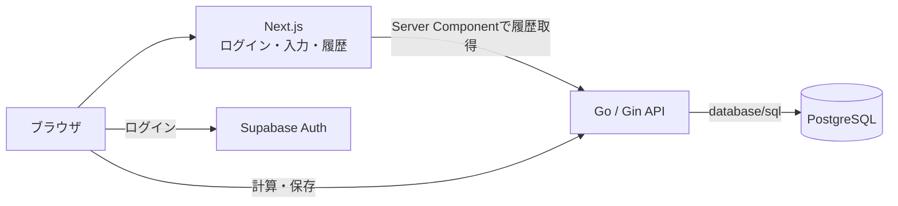
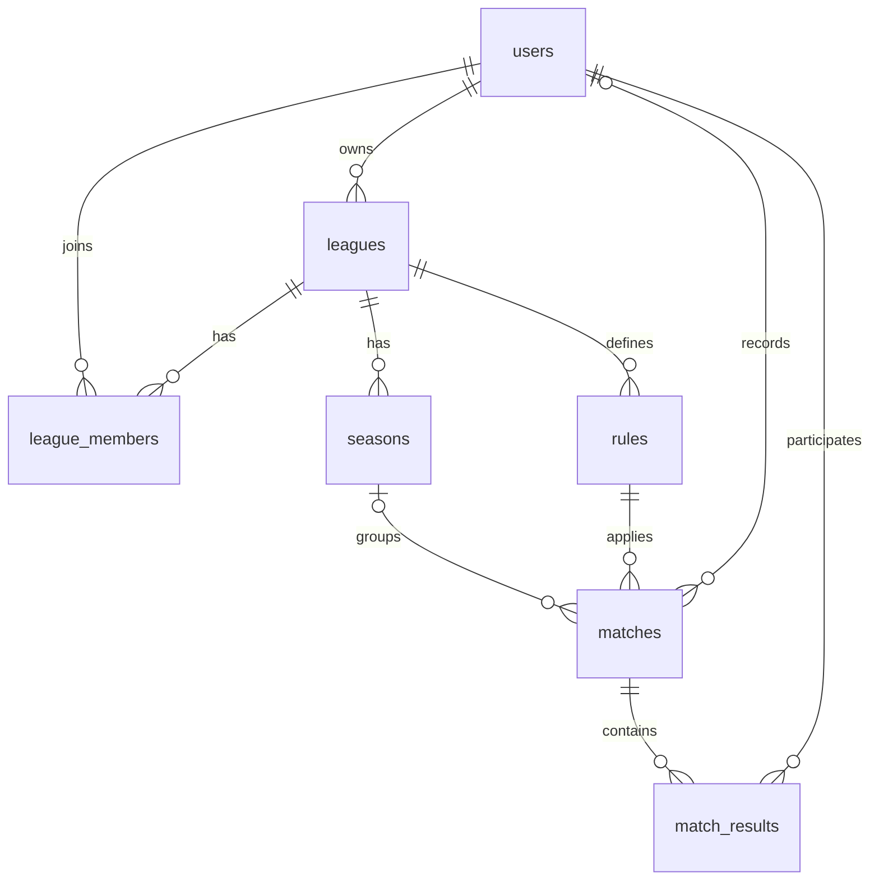
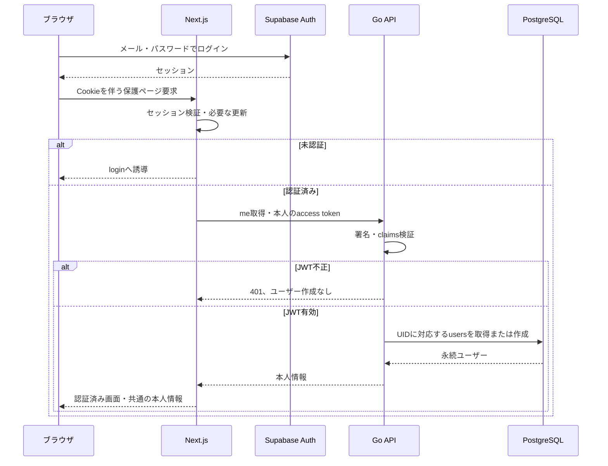

# アーキテクチャとデータ設計

## 現在の構成

| 層 | 実装と主な責務 | 根拠 |
| --- | --- | --- |
| Web | Next.js 16.2.3 / React 19.2.4 / TypeScript。ログイン、対局入力、履歴表示 | [package.json](../web/package.json)、[app](../web/src/app) |
| UI・入力 | Tailwind CSS 4、Base UIを使ったUI部品、React Hook Form、Zod | [UI部品](../web/src/components/ui)、[MatchInputForm](../web/src/components/match/MatchInputForm.tsx) |
| Auth | Supabase Auth。ブラウザのメール・パスワードログインとCookieベースのWebセッション | [login/page.tsx](../web/src/app/login/page.tsx)、[middleware.ts](../web/src/middleware.ts) |
| API | Go。`go.mod` はGo 1.26.2。Gin、`database/sql`、`lib/pq` を使用 | [go.mod](../api/go.mod)、[main.go](../api/main.go) |
| DB | `DATABASE_URL` でPostgreSQLへ直接接続。Supabase上のDBを想定 | [database.go](../api/db/database.go)、[.env.example](../api/.env.example) |

依存関係の正確なバージョンは `web/package-lock.json` と `api/go.sum` を参照する。WebとAPIは別プロセスで、現在はWeb内のRoute Handlerを介さずGoを呼び出す。

これは現在の通信経路。GoのJWT署名検証と対局APIの認証ミドルウェアはまだない。Web側の認証リダイレクトだけでは、直接呼ばれるGo APIを保護できない。

## コードの責務

- `api/main.go`：起動、DB接続、CORS、ルート登録。
- `api/controllers`：HTTP入出力、ポイント計算、SQL、トランザクション。現状はこれらが同居している。
- `api/models`：APIのリクエスト・レスポンス型。DB全体のスキーマ定義ではない。
- `api/db`：接続処理とseed。マイグレーション基盤はない。
- `web/src/app`：画面とServer Componentによる履歴取得。
- `web/src/components/match`：入力・計算プレビュー・保存。現在はメンバー・ルールの取得元に負債がある。
- `web/src/types`：履歴APIのWeb側型。Goの変更と同時に更新する。

今後、認証を共通処理にし、ポイント計算をHTTPや表示から独立して検証できる境界へ置く。リーグ・ルール取得、保存時検証、集計、SVG描画は必要なStepで責務を分ける。将来のためだけに未使用の抽象化や空のレイヤーを大量に作らない。

## 7つのコアテーブル

以下は各テーブルの役割と現在のAPIとの接続状況。実DBの列・型・制約・RLSは後述の調査結果で確認済み。テーブルの存在と、リーグ等の機能をアプリから運用できることは区別する。

| テーブル | 役割 | コード・seedで使われる主な項目 | 現在の接続状況 |
| --- | --- | --- | --- |
| `users` | 登録者・永続ゲストの参加者ID | `id`, `auth_id`, `name`, `created_at` | meのUpsert、結果保存・履歴JOIN、seed。auth_idはDBにあるがGoで未利用。ゲスト操作未実装 |
| `leagues` | コミュニティ・集計・権限の境界 | `id`, `name`, `owner_id` | seedのみ。取得・管理APIなし |
| `league_members` | リーグ所属と役割 | `league_id`, `user_id`, `role` | seedのみ。所属・権限チェックなし |
| `seasons` | リーグ内の成績集計期間 | `id`, `league_id`, `name`, `start_date`, `end_date` | seed、保存APIの引数。選択・管理・集計なし |
| `rules` | 持ち点・返し点・ウマなど | `id`, `league_id`, `name`, `default_points`, `return_points`, `uma_1`〜`uma_4` | seedと対局の参照ID。計算処理はルールを読まない |
| `matches` | 対局単位の記録 | `id`, `rule_id`, `season_id`, `recorded_by`, `created_at` | 保存・履歴あり。APIは記録者を保存せず、DBにmatch_date列はない |
| `match_results` | 対局ごとの参加者・成績 | `id`, `match_id`, `user_id`, `raw_score`, `final_point`, `rank` | 4件の結果保存・履歴あり。guest_name/役満/トビの列はDBにない |

seedは7テーブルを前提にするが、作成用SQLではない。参照関係は次のように想定する。

この図の関連・多重度は目標モデルを説明する。実DBには後述のFKがあるが、nullableな参照もあり、図のすべての必須条件を保証するわけではない。1対局4結果の条件は別途GoとDB設計で担保する。

## データ辞書：確認済みの実DBと設計上の目標

### 設計確認1の調査結果

2026-10-06、開発者からプロジェクト再開の連絡を受け、設定済み接続先の読み取り調査を再実行した。PostgreSQL 17.6へ接続でき、7テーブル・39列・20制約・9 indexを取得した。調査トランザクションは `REPEATABLE READ / READ ONLY`、`transaction_read_only=on` を確認済み。個人の名前・メール・認証情報は取得せず、構造と集計だけを扱った。

最初の接続はプロジェクト停止中に拒否されたが、再開後はDB接続と公開JWKS取得の両方に成功した。停止前の失敗を、現在も接続できない状態として扱わない。環境変数・アプリコード・DBの内容はこの調査で変更していない。

調査クライアントはlibpqで解釈できない `pgbouncer` URIパラメーターだけを接続時に除外し、prepared statementを無効化した。元の設定ファイルは変更せず、接続先・DBユーザーはそのまま使用した。今回の読み取り成功は、Go APIやログインの受入試験に合格したという意味ではない。

| テーブル | 調査時点の件数 | RLS | ポリシー件数 |
| --- | --- | --- | --- |
| `users` | 5 | 有効 | 0 |
| `leagues` | 1 | 有効 | 0 |
| `league_members` | 5 | 有効 | 0 |
| `seasons` | 1 | 有効 | 0 |
| `rules` | 2 | 有効 | 0 |
| `matches` | 19 | 有効 | 0 |
| `match_results` | 76 | 有効 | 0 |

7テーブルとも `FORCE ROW LEVEL SECURITY` は無効で、非内部トリガーは0件。調査接続のロールはsuperuserではないが `BYPASSRLS=true`。RLSを回避しないロールはポリシーなしでは原則行を取得・変更できず、BYPASSRLSロールはRLSを回避する。[PostgreSQL 17のRLS仕様](https://www.postgresql.org/docs/17/ddl-rowsecurity.html) に従い、同じ接続情報を使うGoのSQLに利用者別の認可が自動適用されるとは考えない。テーブルのGRANTと各アプリ経路の実行確認は別に行う。

### 実DBの列・型・NULL・既定値

下表は上記調査時点の実スキーマ。『NULL可』と『既定値あり』は別の性質であり、`now()` が既定値でもNULL禁止とは限らない。項目の業務上の意味は [requirements.md](requirements.md) の用語・B条件、APIへの対応は後述を参照する。

| 項目 | PostgreSQL型 | NULL | 既定値 |
| --- | --- | --- | --- |
| `users.id` | `uuid` | 不可 | `gen_random_uuid()` |
| `users.auth_id` | `uuid` | 可 | なし |
| `users.name` | `character varying(100)` | 不可 | なし |
| `users.created_at` | `timestamp with time zone` | 可 | `now()` |
| `leagues.id` | `uuid` | 不可 | `gen_random_uuid()` |
| `leagues.name` | `character varying(100)` | 不可 | なし |
| `leagues.owner_id` | `uuid` | 可 | なし |
| `leagues.created_at` | `timestamp with time zone` | 可 | `now()` |
| `league_members.league_id` | `uuid` | 不可 | なし |
| `league_members.user_id` | `uuid` | 不可 | なし |
| `league_members.role` | `character varying(20)` | 可 | `'member'::character varying` |
| `league_members.joined_at` | `timestamp with time zone` | 可 | `now()` |
| `seasons.id` | `uuid` | 不可 | `gen_random_uuid()` |
| `seasons.league_id` | `uuid` | 可 | なし |
| `seasons.name` | `character varying(100)` | 不可 | なし |
| `seasons.start_date` | `date` | 可 | なし |
| `seasons.end_date` | `date` | 可 | なし |
| `seasons.created_at` | `timestamp with time zone` | 可 | `now()` |
| `rules.id` | `uuid` | 不可 | `gen_random_uuid()` |
| `rules.league_id` | `uuid` | 可 | なし |
| `rules.name` | `character varying(100)` | 不可 | なし |
| `rules.default_points` | `integer` | 可 | `25000` |
| `rules.return_points` | `integer` | 可 | `30000` |
| `rules.uma_1` | `integer` | 不可 | なし |
| `rules.uma_2` | `integer` | 不可 | なし |
| `rules.uma_3` | `integer` | 不可 | なし |
| `rules.uma_4` | `integer` | 不可 | なし |
| `rules.created_at` | `timestamp with time zone` | 可 | `now()` |
| `matches.id` | `uuid` | 不可 | `gen_random_uuid()` |
| `matches.season_id` | `uuid` | 可 | なし |
| `matches.rule_id` | `uuid` | 可 | なし |
| `matches.recorded_by` | `uuid` | 可 | なし |
| `matches.created_at` | `timestamp with time zone` | 可 | `now()` |
| `match_results.id` | `uuid` | 不可 | `gen_random_uuid()` |
| `match_results.match_id` | `uuid` | 可 | なし |
| `match_results.user_id` | `uuid` | 可 | なし |
| `match_results.raw_score` | `integer` | 不可 | なし |
| `match_results.final_point` | `numeric(6,1)` | 不可 | なし |
| `match_results.rank` | `integer` | 不可 | なし |

`matches.match_date` と `match_results.guest_name` / `is_yakuman` / `is_tobi` は、確認したDBには存在しない。履歴APIは現在このDBでcreated_at・null・false・falseのフォールバックを使う。将来の役満等の列を、現在保存できる項目と混同しない。

### 確認済みの制約

以下の20制約はいずれもvalidated。FKの削除動作は定義をそのまま記録する。明示されない削除動作はPostgreSQLの既定値となる。

| テーブル | 制約名 | 定義 |
| --- | --- | --- |
| `users` | `users_auth_id_key` | `UNIQUE (auth_id)` |
| `users` | `users_pkey` | `PRIMARY KEY (id)` |
| `leagues` | `leagues_owner_id_fkey` | `FOREIGN KEY (owner_id) REFERENCES users(id) ON DELETE CASCADE` |
| `leagues` | `leagues_pkey` | `PRIMARY KEY (id)` |
| `league_members` | `league_members_league_id_fkey` | `FOREIGN KEY (league_id) REFERENCES leagues(id) ON DELETE CASCADE` |
| `league_members` | `league_members_pkey` | `PRIMARY KEY (league_id, user_id)` |
| `league_members` | `league_members_user_id_fkey` | `FOREIGN KEY (user_id) REFERENCES users(id) ON DELETE CASCADE` |
| `seasons` | `seasons_league_id_fkey` | `FOREIGN KEY (league_id) REFERENCES leagues(id) ON DELETE CASCADE` |
| `seasons` | `seasons_pkey` | `PRIMARY KEY (id)` |
| `rules` | `rules_league_id_fkey` | `FOREIGN KEY (league_id) REFERENCES leagues(id) ON DELETE CASCADE` |
| `rules` | `rules_pkey` | `PRIMARY KEY (id)` |
| `matches` | `matches_pkey` | `PRIMARY KEY (id)` |
| `matches` | `matches_recorded_by_fkey` | `FOREIGN KEY (recorded_by) REFERENCES users(id)` |
| `matches` | `matches_rule_id_fkey` | `FOREIGN KEY (rule_id) REFERENCES rules(id)` |
| `matches` | `matches_season_id_fkey` | `FOREIGN KEY (season_id) REFERENCES seasons(id) ON DELETE CASCADE` |
| `match_results` | `match_results_match_id_fkey` | `FOREIGN KEY (match_id) REFERENCES matches(id) ON DELETE CASCADE` |
| `match_results` | `match_results_match_id_user_id_key` | `UNIQUE (match_id, user_id)` |
| `match_results` | `match_results_pkey` | `PRIMARY KEY (id)` |
| `match_results` | `match_results_rank_check` | `CHECK (rank >= 1 AND rank <= 4)` |
| `match_results` | `match_results_user_id_fkey` | `FOREIGN KEY (user_id) REFERENCES users(id)` |

indexは全9件で、上記PKとUNIQUEに対応するもののみ。日時・FK検索用の追加indexはない。`users.auth_id` に `auth.users` を参照するFKはなく、`league_members.role` の許容値CHECKもない。現状のDB制約だけでは、1対局4結果、素点合計、ルール計算との一致、rule/seasonの同一リーグ所属を保証しない。

### 既存データの集計と移行前に決めること

追加の読み取り集計で次を確認した。件数は調査時点の観測値であり、恒久的な固定値ではない。

| 観測 | 結果 | 設計上の扱い |
| --- | --- | --- |
| 参加者のAuth紐付け | 5件すべてauth_idがNULL | 未紐付けの参加者として扱う。名前一致だけで新しいアカウントに紐付けない |
| Authアカウント | auth.usersは0件、同表の非内部トリガーは0件 | 本人での認証受入に必要なテストアカウントを後の実装・検証段階で準備する。今回作成しない |
| シーズンと記録者 | 19対局中18件がseason_id NULL、18件がrecorded_by NULL | 所属期間・記録者を推測で埋めない。既存NULLの扱いを設計する |
| ルールの所属 | rulesの2件ともleague_id NULL | 対局の所属リーグをruleから追跡できない。対応リーグの確認と補完方針が必要 |
| 対局結果の基本整合 | 全19対局が4結果、素点合計100,000、ポイント合計0。結果のmatch_id/user_idのNULLは0件 | 現行の10万点基準の集計確認。個別の順位・ポイント再計算や全ルールの妥当性を検証したものではない |
| 所属role | owner 1件、member 4件 | 管理権限表とNULL/未知roleの扱いは別途設計する |
| ruleとseasonのリーグ比較 | 不一致1件 | rule.league_idが未設定のため比較不一致。旧対局の帰属を確認する |
| 結果と適用ruleのリーグ所属比較 | 76件すべて一致する所属を辿れない | rule.league_idがNULLなので発生する。参加者全員が無所属であるという意味ではない |

削除のCASCADEは users→所有リーグ、リーグ→所属/ルール/シーズン、シーズン→対局、対局→結果にある。削除が過去成績へ波及し得る一方、別のFKにより拒否される場合もある。実際の参照関係に応じてD-14の取消・訂正と履歴保全を設計し、調査を理由に削除・補完を実行しない。

### Authの観測と残る確認

公開JWKSの読み取りで、`alg=ES256` / `kty=EC` の公開鍵1件を確認した。2026-10-06、開発者からDashboardの『Current key』が **ECC (P-256)** であるとの回答を得た。[Supabaseの署名鍵資料](https://supabase.com/docs/guides/auth/signing-keys) ではP-256方式のJWT `alg` は `ES256`。公開JWKSの観測と、現在の発行用キーについての開発者の画面確認を別の証拠として記録する。JWKSの存在だけを根拠に発行用キーを断定したものではない。

issuer/audienceと実際のaccess tokenのclaimsは未観測。署名方式の設定確認、検証すべきclaimsの設計、後の実トークンでの受入確認を分ける。公開鍵の中身やJWT secretは文書へ保存しない。

### APIとの対応とID分離の前提

- `users.id` はUUIDの永続参加者ID、`users.auth_id` はnullableかつUNIQUEのUUID。D-04に必要な対応列は既に存在するが、現在のmeはauth_idを使わずsubをidへINSERTする。
- `users.auth_id` を活用する対応関係、初回作成、既存参加者への紐付け、Auth削除時の扱いを項目2〜4で確定する。既存IDを一括で振り直すことや、同名だけで自動統合することを前提にしない。
- `player_id → match_results.user_id`、`raw_score → 履歴score`、`point → final_point` の対応がある。Goのfloat64とDBのnumeric(6,1)の精度・丸めをD-07で合わせる。
- `seasons.id` / `matches.season_id` はDBでUUID。保存APIの `*int` と不一致が確認された。NULL可否の業務上の選択はD-17で別途決める。
- `matches.recorded_by` はUUID・NULL可・usersへのFK。現在APIが省略してもこの列のNOT NULL違反は起きないが、D-12の操作主体を追跡する要求は満たしていない。
- 履歴の `user_id` は現在u.nameを返す別名であり、DBのuser_idと意味が違う。Go/Web/Postmanを同時に変更する。

業務不変条件は [requirements.md](requirements.md) のB-01〜B-08を正本とする。確認した実体を今後の基準にし、適用可能なマイグレーション・新しい環境の再構築は項目11で整備する。この文書のスキーマ記録は変更を適用するSQLではない。

### 設計確認2：参加者IDと認証ID

D-04の承認済み方針を、既存の `users.id` と `users.auth_id` で具体化する。新しい対応列や別の参加者テーブルを増やす必要は現時点ではない。下表は目標の対応関係であり、現行Goに実装済みの処理ではない。

| 項目 | 意味・制約 | 使用する場所 |
| --- | --- | --- |
| `users.id` | UUIDの永続参加者ID。登録・ゲストの両方に割り当て、登録や認証の変更で振り直さない | 対局結果、リーグ所属、所有者、記録者、将来の分析 |
| `users.auth_id` | Supabaseの `auth.users.id` に対応するUUID。未紐付けはNULL、紐付け済みはUNIQUE | 検証済みJWTの `sub` から参加者を特定する入口 |

既存5参加者は調査時点でauth_id未設定。2026-10-10、開発者がこの5参加者と19対局を動作確認用テストデータと回答した。用途はこの回答で確認したものであり、NULLや名前から推測したものではない。テスト参加者を実際の本人アカウントへ自動紐付けしない。今後の実ゲストについても、名前やメールの一致、あるいはidとsubの値が同じという理由だけで本人への紐付けを自動確定しない。新しいAuthアカウントへの初回作成とゲストの本人紐付けを分け、後者の確認方法はD-15で決める。

Authアカウントの削除と参加者の削除も別の操作。現在auth_idにはFKがなく、削除後の整合性は自動保証されない。D-21で2026-10-08にA案を承認済み。目標では `users.auth_id → auth.users.id` に `ON DELETE SET NULL` のFKを追加し、Auth削除時はauth_idだけをNULLへ戻す。NULL許容・UNIQUEを維持し、参加者ID・結果・既存の参照を削除しない。表示名の扱い、再登録後の本人確認、ownerの引継ぎや所属roleの扱いはこの選択だけでは決まらず、項目4・8・11で具体化する。実DBの列・制約表は変更前の観測として維持する。

[Supabaseのユーザー管理資料](https://supabase.com/docs/guides/auth/managing-user-data) は `auth.users` のPKへの参照と、通常のプロフィールの削除連動例を示している。MJ-Statsのusersは対局参加者の永続IDも担うため、その例の `ON DELETE CASCADE` をそのまま適用しない。また、Auth削除後も発行済みJWTは期限まで署名上有効になり得る。D-21のFK設計だけでアクセス停止を保証したとは扱わず、項目3で主体の存在確認・meの初回作成・削除済み主体の拒否を整合させる。

初回表示名はD-22で2026-10-10にA案を承認済み。meで参加者を自動作成し、本人が表示名を設定してから通常利用へ進める。現在のメールのローカル部を名前に使う処理は目標に引き継がない。既存参加者の取得で表示名を上書きしない。D-24/D-25も同日にA案を承認済み。表示名は前後の空白を除いて1〜30文字・同名可とし、設定後は本人が変更できる。履歴画面は現在の表示名を使う。

#### 表示名の検証・変更

- 長さは前後の空白を除いた保存値のUnicodeコードポイント数で数える。UTF-8のバイト数やJavaScriptのUTF-16長では判定しない。結合文字や複数コードポイントの絵文字はその数で数える。正規化による別名への置換・大文字小文字の同一視・同名の統合は行わない。
- 改行・Unicode制御文字（Cc）・行区切り/段落区切りを、前後にあっても拒否する。前後の空白除去より先に禁止文字を検査する。空白除去にはGo/Webで同じUnicode White_Spaceの範囲を使い、判定の違いをfixtureで確認する。空白のみは不可、名前内部の通常の空白は許可する。
- Goで必ず再検証し、Webにも同じ規則を適用する。DBの現varchar(100)はそのまま観測として記録し、追加のDB制約の要否は項目11で統合する。users.nameにUNIQUEを置かず、参加者選択の同名をIDで区別する。
- 本人の更新対象は検証済みAuth UIDからGoが特定する。bodyによる他人のid指定、auth_id・role・所属・素点等の変更を表示名更新に混ぜない。初回設定と後の変更は同じ入力規則を使う。
- 変更後に履歴を再取得すると現在の名前を返す。対局の参加者ID・記録者・点数・順位は変更しない。ゲスト名の変更権限は項目4・8、生成済み共有画像の扱いはPhase 4で具体化する。

#### 初回・並行作成と表示名設定の設計案

以下は承認済みD-04/D-21/D-22を実現する処理案。コード・DBは未変更であり、最終のAPI契約・移行設計は項目9・11で統合する。

1. GoがJWTとAuth主体を検証し、検証済みsubから `users.auth_id` を検索する。主体の存在確認と削除との競合は項目3で具体化する。
2. 対応する参加者があれば同じid・表示名を返す。存在しなければDBのUUID既定値で新しいidを生成し、検証済みAuth UIDをauth_idへ設定する。名前・メール・未紐付けidの値が一致しただけで既存参加者を取得しない。初回作成はリーグへの自動参加や管理権限の付与を伴わない。
3. auth_idのUNIQUEを競合判定に使い、並行初回アクセスでも1参加者だけを残す。競合したリクエストも同じ既存参加者を取得し、表示名や設定状態を上書きしない。単純な『SELECTで不在→無条件INSERT』だけで重複・不必要な500を防げたとは扱わない。
4. 現在nameはNOT NULLなので、作成中はメールを含まない仮名 `Player` を使う設計案とする。名前設定の完了には独立した永続状態が必要。候補はnullableな `profile_completed_at`（timestamptz）。文字列がPlayerかどうかで判定しないため、本人がPlayerを選んでも完了を表現できる。列の最終定義と既存データ補完は項目11で確定する。
5. Webは未設定なら初回設定へ誘導し、me・本人の表示名設定・ログアウト等の完了に必要な操作を許可する。通常のリーグ成績・対局操作は設定完了後に許可する。Goでも設定状態を検証し、直接APIを呼んで迂回できないようにする。対象API・ステータスは項目9で確定する。
6. 表示名の保存と完了状態の更新を同じ処理で行う。失敗時は未完了のまま入力を保持して再試行でき、成功後は再読込でも同じ参加者と完了状態を使う。初回設定はAuth UID・参加者ID・所属・roleを書き換える操作にしない。

ゲストのauth_idがNULLであることと、登録者の名前設定が未完了であることは別。ゲストはログインの設定画面へ誘導しない。本人紐付け時に既存名をどう確認するかはD-15と初回導線の統合時に定める。既存5参加者・19対局は動作確認用と確認済みなので、実アカウントの初回設定を既存テスト参加者への自動紐付けで済ませない。元DBの削除・リセットは行わず、専用環境でのfixture再構成・保持を項目11で具体化する。

項目2のID・表示名・既存データ分類は整理済み。API型・状態の最終契約は項目9、画面は項目10、FK・名前設定状態の移行とテスト環境は項目11へ引き継ぐ。実ゲストの本人紐付けはD-15・項目4で所属と権限に合わせて決める。これは項目2の対象外条件を明示したものであり、全1〜12の設計完了や実装開始を意味しない。今回はFKの追加・Auth削除・名前変更・参加者への紐付けを実行しない。

## 認証と認可の境界

**Step 1の承認済み方針：** `/api/users/me`, `POST /api/matches`, `GET /api/matches`, `POST /api/matches/calculate` を保護する。`GET /api/health` は公開する。

認証は「誰か」、認可は「そのリーグで何ができるか」の確認。SupabaseのJWTにある一般的な認証roleを、`league_members.role` のowner/admin/memberと同一視しない。Webの状態やリクエストbodyにあるID・roleを権限の根拠にしない。

Step 1の設計では次を満たす。

1. Bearer JWTの署名、許可アルゴリズム、issuer、audience、期限、subjectを検証する。subjectは期待するAuth UID形式を確認する。
2. 確認済みのECC (P-256) / ES256に対応し、信頼するSupabaseプロジェクトのJWKSと `kid` を使う。鍵更新・キャッシュ・タイムアウトと許可アルゴリズムの詳細は項目3で確定する。トークン内のURLを鍵取得先として信頼しない。
3. 公開anon/publishable keyをJWT検証用secretとして使わない。検証に失敗したときに共有secretや未検証の解析へ切り替えない。署名方式を変更する場合は設定・契約・受入ケースを見直す。
4. D-04に従い、検証済みAuth UIDからアプリの `users.id` を対応付ける境界を用意する。現在のmeは両者を同じ値にしているが、目標ではIDの意味を分離する。各画面や所属SQLで `sub = users.id` と決め打ちしない。
5. 不正・未認証は401、将来の認可拒否は403。DBや鍵取得サービスの障害は正常な認証として通さず、サーバー障害と区別できるようにする。

非対称鍵の公開鍵取得とローテーションは [Supabase JWT Signing Keys](https://supabase.com/docs/guides/auth/signing-keys) を参照する。現在の発行用キーは開発者のDashboard確認でECC (P-256)、公開JWKSの観測はES256。実トークンの検証成功は後の受入確認で取得する。

WebではCookieからセッションを取り出すことと、認証を検証することを分ける。現在のmiddlewareは `getUser()` を使っている。今後の共通処理では、[SupabaseのSSR資料](https://supabase.com/docs/guides/auth/server-side/nextjs) に基づき `getClaims()` / `getUser()` による確認を行い、`getSession()` のuser情報だけで認可しない。

Goへはユーザーのaccess tokenを渡す。Server Componentの履歴取得にも転送が必要。ブラウザのCookieをそのままAPIへコピーせず、refresh token・DB接続情報・service roleをWebの公開情報へ含めない。CORSの許可origin・headerと認証対象外のpreflightも合わせて確認する。

GoはPostgreSQLに直接接続する。今回の同じ接続情報による調査ではBYPASSRLS=true、7テーブルのRLS有効・ポリシー0件を確認した。Supabase Authを使うだけでGoのSQLにユーザー別RLSが適用されると考えず、リーグへのアクセスをGoで制御する。接続ロールの権限とDB側の追加防御の具体化は、運用・移行設計でも扱う。

### 設計確認3：登録・戻り先・ログアウト

D-26の自己登録、D-27の元画面への復帰、D-28の現在のブラウザの任意ログアウト、D-29の普段のログイン維持、D-30のメールによるパスワード再設定は承認済み。基本仕様と技術案を記録し、具体的な画面/API契約・実設定・移行を項目9〜11で統合する。

- 登録入口：D-26に従いメール確認と確認後のログイン・初回名前設定への導線をStep 1へ追加する。資格情報と確認処理はSupabase Authに任せ、パスワードDBや確認トークンをアプリ独自に作らない。meの参加者作成とリーグ参加を分離する。招待・リーグ参加の方法は項目4、パスワード再設定等の範囲・メール配送・許可URLは後続で具体化する。現在のSupabase登録設定は画面の存在から推測しない。
- 回復：D-30に従い、本人のメール再設定の導線をStep 1へ含める。[Supabaseのパスワード認証資料](https://supabase.com/docs/guides/auth/passwords) に沿い、resetPasswordForEmailで依頼し、確認後の有効な本人セッションからupdateUserで更新する。依頼受付を実配送の成功と混同せず、アカウントの存在を示さない案内にする。期限切れ/不正な確認では更新させず、再依頼へ誘導する。参加者・所属・成績を再作成しない。確認コード方式・画面/URL・更新失敗・完了後のセッションを項目9〜11で統合する。
- ログイン後の戻り先：D-27に従い元画面へ戻す。アプリ内の許可されたパスだけを採用し、外部URL・認証画面への循環を拒否する。戻り先がなくてもアプリ入口へ進める。初回名前設定は戻り先より優先し、移動先で所属・権限を再確認する。戻り先の保存だけで対局フォームの未保存入力まで復元できるとは扱わない。下書き保持は項目10で範囲を決める。
- ログアウト：[Supabaseの公式資料](https://supabase.com/docs/guides/auth/signout) では `local` が現在のセッション、`global` が全セッションで、JavaScriptの既定はglobal。D-28に従いlocalを明示する。Cookie・本人の共通状態・取得済みデータを破棄し、同じセッションを使うタブと保護ページの再取得でも認証を確認する。別セッションの他ブラウザ・端末は維持する。失敗時にAuth側の終了を完了したと表示しない。

発行済みaccess tokenはログアウト後も期限まで署名上有効になり得る。[セッション資料](https://supabase.com/docs/guides/auth/sessions) は `session_id` と `auth.sessions` の対応を用いた終了確認を説明している。Goの各保護APIで、署名/claims検証に続いてAuth主体と対応セッションの有効性を確認する設計とする。鍵取得・DB障害は認証を省略せず内部障害として扱う。

JWT検証はSupabaseの [JWT資料](https://supabase.com/docs/guides/auth/jwts) と [claims一覧](https://supabase.com/docs/guides/auth/jwt-fields) を根拠に、固定プロジェクトのES256/JWKS、issuer/audience/期限/sub/セッションの条件を具体化する。設定確認済みの鍵方式、採用する検証条件、実トークンの後の受入結果を区別する。ユーザーに暗号ライブラリや鍵キャッシュの細部を一つずつ選ばせず、技術的手段を設計案と検証ケースへまとめる。

#### JWT・セッション検証の処理設計案

以下は承認済みの振る舞いを満たす技術設計案。ライブラリ・応答契約・移行に必要な条件を具体化し、項目9・11と総合レビューで統合する。実装・受入試験は未実施。

| 条件 | 検証・処理 |
| --- | --- |
| 鍵・署名 | 既存依存のgolang-jwt/jwt/v5を使い、ES256だけを許可。kidに対応する固定プロジェクトのEC/P-256公開鍵で検証。none/HS256/RS256やトークンが指定するURL・埋込み鍵を受け入れない |
| 発行者 | Go用のSUPABASE_URLから導く `<project URL>/auth/v1` とissを完全一致で比較。環境間・別プロジェクトのJWTを拒否 |
| 対象・認証主体 | audにauthenticatedを要求、roleはauthenticated、is_anonymousはfalse。subとsession_idは非空のUUID。anon/service_role APIキーや匿名Authを登録者として受け入れない。アプリの永続ゲストは匿名Authと別概念 |
| 時間 | expを必須として確認。iatの欠落/不正値・将来発行、存在するnbfの未来を拒否。時計差の許容は初期案30秒とし、境界fixtureを用意する。許容を超えて期限切れのJWTは401 |
| Auth主体 | auth.users.id=sub、deleted_atがNULL、banned_untilが未設定または過去、メール確認済みを確認する。削除/未確認/停止中の主体を参加者作成に利用しない |
| セッション | auth.sessions.id=session_idかつuser_id=sub、not_afterがNULLまたは現在より後であることを確認する。行がない・別主体に属する・明示期限切れの場合は401 |
| 参加者 | 検証後にusers.auth_idから永続idへ対応付ける。meだけが初回作成を行い、他の通常操作では名前設定済みの参加者を要求する。bodyのid/roleは本人・権限の根拠にしない |
| 更新・再試行 | refreshはWeb/Supabase SDKが扱う。Goにrefresh tokenを送らない。GETや計算は更新後に最大1回再試行可能。保存の通信失敗/内部障害を自動再送しない。認証層で副作用前に返した401の再試行と、結果不明の保存再送D-13を区別する |

issuer/audience等は公式仕様に基づく採用予定の条件であり、実トークンを観測した値ではない。確認コード・有効なセッションのないAPIキー等を同じ入口へ通さない。Supabaseの時間制限設定の現値は未確認で、独自の定期再ログインを追加しない。不活動タイムアウト等を採用する場合は更新時の扱いも再設計する。

JWKSは固定HTTPS URLから取得する。初期の技術案はアプリ内キャッシュ5分、取得タイムアウト3秒、応答上限256KiB、未知kidの更新は1回で同時取得をまとめ、連続更新の冷却30秒。正常取得後も該当鍵がなければ401、信頼できる鍵を取得できなければ503とする。キャッシュ期限切れの鍵を障害時に無期限で使わない。[Supabaseの鍵キャッシュ仕様](https://supabase.com/docs/guides/auth/signing-keys) も考慮し、鍵失効の反映を即時保証とはしない。鍵変更時のキャッシュ破棄・再起動・受入手順は項目11で整備する。

#### Authメタデータの読み取り証拠と並行終了

2026-10-10にREAD ONLY/REPEATABLE READの追加調査を実施し、以下の必要列の存在・型・NULLと現接続ロールのSELECT権限を確認した。authスキーマのUSAGEも有効。アカウント・セッションの行や資格情報の値は取得していない。これは7コアテーブルの実体記録とは別の、Auth管理テーブルの一部の観測である。

| 列 | 型・NULL |
| --- | --- |
| auth.users.id | UUID、NULL不可、PK |
| auth.users.email_confirmed_at / banned_until / deleted_at | timestamptz、NULL可 |
| auth.sessions.id | UUID、NULL不可、PK |
| auth.sessions.user_id | UUID、NULL不可、auth.users.idへのON DELETE CASCADE FK |
| auth.sessions.not_after | timestamptz、NULL可 |

Auth主体/セッションの有効性を成功キャッシュへ長時間保持しない。ログアウト完了後に開始する要求は終了済みセッションで拒否する。すでに処理中の要求を完了後に取り消す保証はしない。meの初回作成・名前更新・対局保存などの書き込みは、トランザクション内でも主体/セッションを再確認し、該当行の共有ロックで並行削除との順序を定める案とする。書き込みが先にロックを取得してコミットした場合は、その完了後にログアウト/削除が完了し、逆順なら書き込みを拒否する。トランザクションは短く保ち、JWTの期限も書き込み前に再確認する。

[PostgreSQLのSELECT仕様](https://www.postgresql.org/docs/17/sql-select.html) による行ロックには読取以外の権限が必要。今回確認したSELECT権限だけで実行可能と判断しない。Auth管理表への広いUPDATE権限を通常Goロールへ追加せず、必要なら固定search_path・限定EXECUTE権限のDB関数に境界を閉じる。関数/ロール・ロックの権限・タイムアウト・戻し方を項目11で確定する。既存7テーブルの参照は維持し、Auth表のスキーマやデータを独自に更新しない。

不正認証は401、名前未設定や所属拒否は403、鍵取得/DBの一時障害は503、予期しない実装エラーは500を初期契約案とする。失敗時はユーザー/対局の副作用なしを確認する。共通JSONコードとレスポンス本文・再試行条件は項目9で統合し、SQL詳細やJWTを外部・ログへ出さない。

#### ログイン状態の維持と提供形態

D-29に従い、同じブラウザで再訪した際は保存済みセッションを復元して検証し、利用できるならログイン画面を出さない。access tokenが期限切れでもrefresh tokenで更新できれば通常利用を継続する。セッションは保存・復元・更新、APIは各要求の認証検証を担当するため、利用者の再入力なしに安全な検証を続けられる。[Supabaseのセッション仕様](https://supabase.com/docs/guides/auth/sessions) と [SSRの保存・更新資料](https://supabase.com/docs/guides/auth/server-side/advanced-guide) を根拠に実装設計を行う。

Webは既存の `@supabase/ssr` が扱うCookieをブラウザ/サーバーで整合させ、Proxyの通常応答・redirectの両方へ更新Cookieを引き継ぐ。認証に関わる応答・本人データを共有キャッシュへ置かない。ブラウザ終了時にセッションを破棄する独自処理や短いCookie寿命を加えて、利用者を毎回ログアウトさせない。SDK更新失敗が通信障害の場合は再試行可能な状態を示し、無効なrefresh tokenの場合は再ログインへ誘導する。失敗中に認証を省略して通す処理は置かない。

現在はNext.jsのWebアプリであり、ストア配布用ネイティブアプリやインストール用manifest・service workerは確認できない。スマホ向けWebでもログイン維持を設計できる。[Next.jsのPWAガイド](https://nextjs.org/docs/app/guides/progressive-web-apps) はWebをホーム画面から利用する形を説明している。PWAの提供とネイティブの提供は別の選択であり、項目10で対象端末・インストール導線・対応範囲と合わせて判断する。PWAを採用してもブラウザと保存領域・ログイン状態を常に共有できるとは仮定せず、対象OSで確認する。現在の構成からは、スマホ向けWebを基盤にPWAを必要時に加える案を提案するが、PWAの実装着手を承認済みにはしない。

### Step 1の目標シーケンス

以下は設計上の責務を示す目標であり、現在完成している処理ではない。ID分離とproxy.tsへの移行はD-04/D-09で承認済み。JWT鍵方式と実スキーマは確認済み。Webの共通状態、ID対応の処理・移行、削除済み主体の拒否は項目2〜3の設計で具体化する。

図ではServer Component経由のme取得を例示する。ブラウザから取得する構成でも、Goで検証してから本人レコードを利用する境界は同じ。各保護APIはこの初回取得に依存せず、その要求のJWTを再検証する。リーグに対する閲覧・記録の認可はこの認証シーケンスに続く別の確認であり、D-11/D-12で条件を定める。

## 設計確認4の確認対象

D-31/D-32もA案で承認済み。名前設定済みの登録ユーザーがリーグを作成でき、検証済み作成者を初期ownerとしてリーグと所属を同一トランザクションで保存する。owner_idとleague_membersのownerが同じ参加者を指し、失敗時は片方だけを残さない。初期ルール・シーズンは項目5・6で具体化する。

参加は有効な招待から行い、通常の運営承認は不要。リンクの表示をGETしただけで所属を変更せず、登録/ログイン/名前設定後の本人による参加要求をGoで検証する。D-33で発行から7日有効・複数人が使える共通招待と失効/再発行を承認済み。Goが対象リーグ・有効期限・失効状態等と本人を確認してmember所属を保存する。すでに所属している本人なら重複せず、roleを下げない。未所属者には参加画面に必要な最小情報だけを提示し、成績・メンバー詳細は返さない。発行/失効の操作権限と除名後の参加は項目8、保存モデルとAPI契約は項目9・11で統合する。

### 役割と本人紐付けの承認

D-08でowner/admin/memberの3段階を承認済み。roleはリーグごとに取得し、本人の認証、参加者状態、操作対象のリーグを合わせてGoで認可する。ゲストのmember関連はログイン権限を生まない。NULLや未知のroleを運営として扱わない。初期owner・通常参加のmember・adminへの委任と、招待/訂正/取消/本人紐付け等の操作別権限を項目8の表で確定する。

D-15では、ゲスト成績の本人紐付けを運営が確認・承認する方式を採用した。技術案の流れは、本人が登録・名前設定・対象リーグへ参加→対象ゲストを指定した申請/同意→運営が本人と対象を確認→Goが対象と承認権限を再検証→対応関係と承認記録を一括保存。同じ名前のアカウント作成や通常のリーグ参加だけでゲストを取得させない。未承認・他リーグ・他人による指定では対応関係を変更しない。

meが先に作った登録参加者Pと、過去結果の参加者Gが別IDであるケースを通常の前提にする。Pにすでに成績/所属がある場合や、複数リーグで別の旧ゲストIDが存在する場合も、P/Gの行・対局参照を削除して解決しない。auth_idのUNIQUEを維持し、Auth UIDを全旧ゲスト行へ書き込む方式は採らない。過去の参加者IDを保ち、本人の登録参加者との補助的な対応を保存するモデルを項目9/11で具体化する。履歴の原IDと、同じ本人として扱う集計/表示のIDを区別し、1卓に同じ本人を異なる旧IDで二重に入れることもGoで拒否する。

既に別アカウントへ紐付いたゲストは通常の承認で上書きしない。誤承認の訂正、解除済み登録者の再紐付け、補助関連の循環/競合、変更記録・表示名の解決を項目8/9/11で統合する。この技術案は、原IDを維持するD-04と現在のauth_id UNIQUEを両立させるためのものであり、対応表や追加列をDBへ適用したという意味ではない。

### 参加入口：リンク・検索・グループ番号

開発者がD-34/D-36のA案を承認し、3入口と共通の招待条件を確定した。以下は目標の操作であり、現行Web/APIには未実装。

| 入口 | 使う場面 | 共通の参加処理 |
| --- | --- | --- |
| 招待リンク | LINE等で届いたリンクを開く | 招待資格をリンクから引き継ぎ、ログイン/名前設定後に参加操作する。コードの手入力は不要 |
| グループ番号 | 対面や口頭で番号を教わる | 番号で対象を見つけ、運営から教わった参加コードを入力して参加する |
| 名前検索 | グループ名は分かるがリンクが手元にない | 検索への掲載が認められた候補から選び、参加コードを入力して参加する |

グループ番号はリーグを特定する使いやすいIDとして設計し、内部のleagues.id（UUID）とは分ける。参加コードは共通招待を入力するための資格情報であり、番号と区別する。D-36に従い、リンクとコードが同じ有効期限/失効状態を参照する。7日で変わる参加資格と、通常は維持するグループ番号を混同しない。技術案は番号を先頭0も保持できる文字列の一意な数値IDとし、UIの区切り記号を入力時に除く方式。番号/コードの桁数・形式・衝突時の再生成・試行制限・保存方法はAPI/移行設計で具体化する。

3入口を『見つける→必要な場合だけログイン/名前設定→招待を確認→本人の参加操作→所属を確認』へ接続する。既存の有効セッションなら再ログインしない。登録/確認の間に招待が期限切れとなった場合は新しい招待へ誘導し、古い参加資格で所属を作らない。GET/検索だけでは所属を書き込まない。通常memberとして参加し、招待データやbodyのroleでowner/adminに昇格させない。すでに所属済みなら重複作成・role変更なしで通常のリーグ導線へ進む。招待を失効/再発行しても既存の所属者を退出させない。

検索の掲載範囲D-35を次に確認する。提案は運営が掲載を選べ、初期非掲載とする方式。検索をログイン/名前設定済み利用者向けとし、候補には掲載が認められたリーグの名前・番号等の最小情報だけを返す技術案。非掲載でも有効な招待や番号から参加画面へ辿れる。掲載と成績の公開は別であり、番号や検索結果だけで成績・メンバー詳細・招待資格を返さない。[OWASPの認可資料](https://cheatsheetseries.owasp.org/cheatsheets/Authorization_Cheat_Sheet.html) の要求ごとの権限確認を、既存のD-11/D-12を守る設計へ適用する。参加判定と所属の作成をGoで共通化し、入口ごとの権限差や抜け道を作らない。

リーグ名は一意とは限らないため、検索結果と選択・参加は永続ID/番号で対応させる。検索の正規化・一致条件・ページング・結果の上限と、存在しない/非掲載/無効招待の応答契約は項目9/10で定義する。コードの試行制限と秘匿、招待URL/コードがアクセスログへ出ない設定は項目11で整備する。除名済み登録者の再参加はD-38の回答後に状態表と参加判定へ反映する。

#### 未登録ゲストのリーグ別管理と登録への案内

D-05により未登録ゲストをリーグごとに管理する方針を承認済み。再利用とは、以前に記録したゲストを選び、同じ参加者IDへ次の対局結果を追加すること。ゲストをDBに永続化し、同じリーグの対局ごとに別人として作り直さない。複数リーグで継続利用したい人にはユーザー登録を案内する。

| 利用 | 扱い |
| --- | --- |
| 未登録の太郎がwatnowで翌週も対局 | 同じリーグの永続ゲストIDへ記録を継続する |
| 未登録の太郎が複数リーグで継続利用したい | ユーザー登録を案内する。別リーグのゲストIDを共通一覧から選ばせない |
| 登録した太郎が別リーグへ参加 | 自分のアカウントで有効な招待から参加し、成績・閲覧はリーグ別に扱う |
| 同名の別人が対局 | 別の永続IDで記録する。名前一致で統合しない |

登録は複数リーグで同じ本人アカウントを使う入口として案内し、認証済み記録者による通常のゲスト記録は維持する。本人を確定できない未登録者を名前等で追跡し、別リーグへのゲスト参加を一律禁止する仕組みは追加しない。未認証のゲスト本人へリーグ成績を公開する導線にも変更しない。案内の位置・文言は項目10で、本人紐付けと過去成績の維持はD-15で具体化する。

D-18の技術案は、ゲストの作成と対象リーグのleague_members関連を同一トランザクションで保存し、対象リーグの候補だけを取得する方式。Goでも別リーグの未登録ゲストIDの直接指定を拒否する。ゲストのAuth紐付けなしと、そのリーグの参加者であることを区別し、ゲストに閲覧・記録・管理APIの権限を与えない。通常の初期ゲストのroleはmemberとする案だが、参加者種別・制約・Auth削除後の状態は項目9/11で定義する。

Auth削除でauth_idがNULLになった元登録者を、その値だけで『新しい未登録ゲスト』と判定しない。複数所属・owner等の既存参照を保持するD-21と、未登録ゲストのリーグ別管理を両立させる状態表を設計する。テーブルの選択は技術案として具体化し、業務方針D-05を選び直す質問は行わない。

D-08/D-15/D-33/D-34/D-36の基本方針は承認済み。次は検索掲載D-35、ゲスト作成者D-37、除名後の再参加D-38をまとめて確認する。操作別の権限・補助関連・制約と画面/APIへの対応は項目8〜11で統合する。未決定の仕様を実装済みと扱わず、全1〜12の総合レビューで整合を確認する。

## データ整合性の原則

保存時の正しさはGoを基準にする。現在の実装不足は [features-api.md](features-api.md) の負債一覧を参照する。

- 4人、参加者IDの重複なし、許容する点数単位・範囲を検証する。トビを想定し、負点を一律禁止しない。
- 合計持ち点が適用ルールの開始時総点と一致することを検証する。現在の四麻基準は `4 × 25,000 = 100,000`。今後も常に10万点と決め打ちしない。
- Goで適用ルールから順位・最終ポイントを算出し、クライアントの計算済み値をそのまま信用しない。同点・丸め・端数配分は仕様として決める。
- rule、season、参加者が対象リーグに属すること、操作者の権限、対象シーズンに記録できることを確認する。
- 対局と4結果を1トランザクションで保存する。既存実装のこの性質を維持し、ゲスト作成・再利用時にも中途半端な参照を残さない。
- DBの参照・一意制約も確認・管理する。APIのチェックだけで他経路からの不正データを防げると考えない。
- 認証主体が確定したら、記録者はサーバー側で設定できる設計にする。クライアント任せにしない。

## 最終構想を阻害しない条件

| 領域 | 維持する条件 | 決める時期 |
| --- | --- | --- |
| ゲスト | DBに安定したIDを持ち、同じ人の再利用と将来の登録アカウントへの紐付けを可能にする。名前一致だけで自動統合しない | Step 3・D-04/D-05 |
| 履歴 | `user_id` はIDとして返し、名前は別項目で返す。同卓者を分析できる原データを残す | Step 2〜3 |
| ルール | 過去対局の適用条件を再現できる。使用済みルールの変更で過去成績が変わる状態を避ける | Step 2・D-06 |
| 得点 | raw score・順位・final pointを区別する。現在のfloat64の精度・丸めを評価し、集計や精算に必要な表現を決める | Step 2・D-07 |
| 役満・トビ | 書き込み・読取り・集計の意味を一致させる。表示バッジがあることを記録機能完成と扱わない | Phase 3 |
| SVG | 集計値・表示ラベル・配色の入力とSVG描画を分離する。画面のDOMからしか結果を取得できない設計にしない | Phase 4 |
| シーズン | 過去の対局を削除せず、集計対象の切り替えとアーカイブで「リセット」を実現できるデータを保つ | Phase 5 |
| 精算 | 競技成績と飛び賞等を含む精算ポイントの関係を仕様化し、過去の適用条件を追跡する | Phase 5 |

ゲストは「未登録の対局参加者」であり、Supabaseの匿名ログイン機能と同義ではない。ログインしない参加者も、認証済みの記録者が登録できる形を検討する。追加列・統合処理・権限の具体化は、[判断事項](decisions.md) の承認後に行う。
